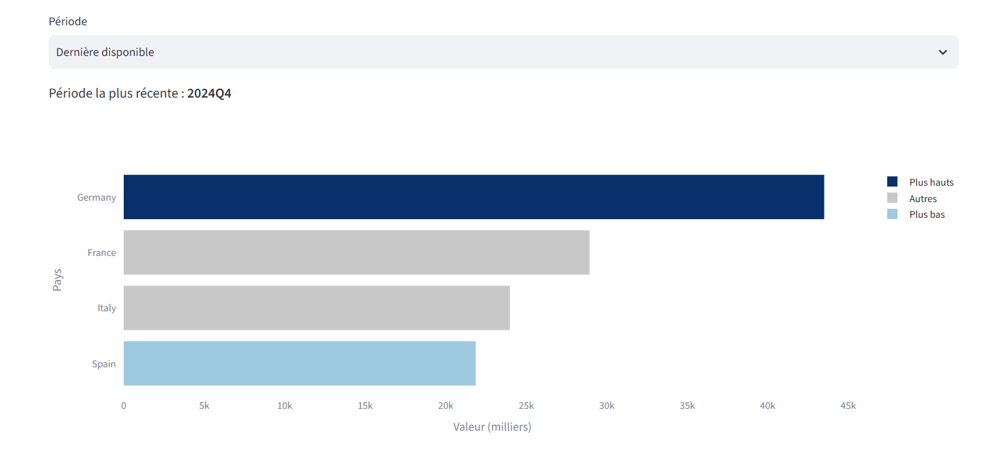
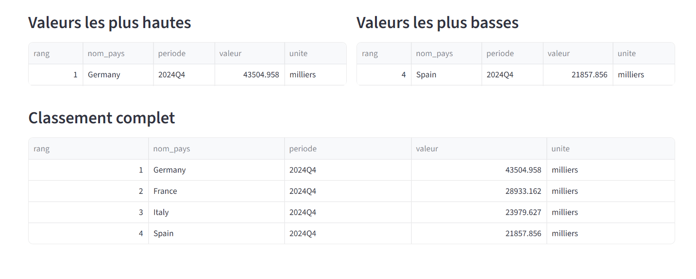
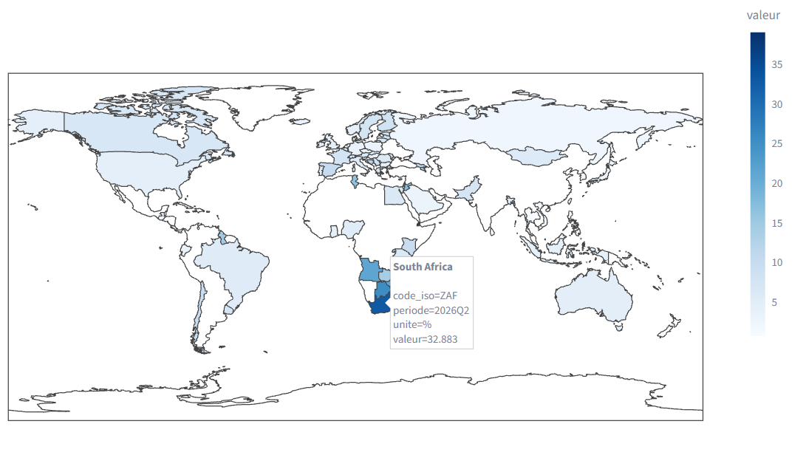

```{r setup, include=FALSE}
# 0. Configuration globale pour la création du document

knitr::opts_chunk$set(
  echo      = FALSE,
  warning   = FALSE,
  message   = FALSE,
  fig.align = "center",
  out.width = "90%"
)

# Couleurs utilisés
COL_MAIN    <- "#1565C0"
COL_ACCENT  <- "#7B2FBE"
COL_THIRD   <- "#FF6F00"
COL_NEUTRAL <- "#546E7A"

library(ggplot2)

# Theme ggplot customisé
theme_ise <- function() {
  theme_bw(base_size = 11) +
  theme(
    axis.title       = element_text(color = COL_MAIN, face = "bold", size = 10),
    axis.text        = element_text(color = "#6B7C85", size = 9),
    plot.title       = element_text(color = COL_MAIN, face = "bold",
                                    size = 12, hjust = 0),
    plot.subtitle    = element_text(color = COL_MAIN, size = 9),
    legend.title     = element_text(color = "#1A6B8A", face = "bold", size = 9),
    legend.text      = element_text(color = "#6B7C85", size = 9),
    legend.position  = "top",
    strip.background = element_rect(fill = COL_MAIN),
    strip.text       = element_text(color = "white", face = "bold", size = 9),
    panel.grid.major = element_line(color = "#E0F4FF", linewidth = 0.4),
    panel.grid.minor = element_blank(),
    panel.border     = element_rect(color = COL_MAIN, linewidth = 0.5),
    panel.background = element_rect(fill = "transparent"),
    plot.background  = element_rect(fill = "#F4F7FC", color = NA)
  )
}

theme_set(theme_ise())

library(kableExtra)

# Theme générique du tableau utilisé dans Quarto
kable_ise <- function(df, caption = NULL, digits = 3,
                      col.names = NULL, escape = TRUE, source = "Source : Nos analyses sous R, WDI(2024)", ...) {
  k <- knitr::kable(
    df,
    format    = "latex",
    booktabs  = TRUE,
    digits    = digits,
    caption   = caption,
    escape    = escape,
    col.names = if (is.null(col.names)) colnames(df) else col.names,
    ...
  )
  k <- k %>%
    footnote(
      general = source,
      general_title = ""
    )
  k %>%
    kable_styling(
      latex_options = c("HOLD_position"),
      font_size     = 11
    ) %>%
    row_spec(0, bold = TRUE, color = "white", background = "#1565C0") %>%
    row_spec(seq(1, nrow(df), 2), background = "#E0F4FF")
}
```

\tableofcontents
\newpage
\listoftables
\newpage
\listoffigures
\newpage

```{=latex}
\mychapterstar{REMERCIEMENTS}

```

Nous tenons à exprimer notre sincère gratitude à toutes les personnes qui ont contribué, de près ou de loin, à la réalisation de ce projet.

Nos remerciements vont tout d'abord à **M. Ludovic DENEUVILLE**, responsable du module, pour son encadrement.

Nous remercions tout particulièrement **M. Anas KNEFATI**, notre tuteur, pour sa disponibilité, la pertinence de ses conseils et ses remarques constructives, qui nous ont permis de faire progresser le projet à chaque étape.

Nous adressons également nos remerciements à l'ensemble de l'équipe pédagogique de l'École nationale de la statistique et de l'analyse de l'information (ENSAI) pour la qualité de la formation dispensée et les ressources mises à notre disposition.

Enfin, nous félicitons les membres du groupe pour leur investissement, leur esprit d'équipe et leur bonne humeur durant ces mois de travail. \newpage

```{=latex}
\mychapterstar{Résumé} 
```

Le projet **LaborScope** vise à rendre accessible l'exploration des données du marché du travail mondial, issues de la base ILOSTAT de l'Organisation internationale du Travail (OIT). Cette base, très riche, rassemble de nombreux indicateurs (emploi, chômage, secteurs d'activité, inégalités entre les sexes...), mais sa taille et sa complexité en limitent l'usage par des utilisateurs non spécialistes.

Pour répondre à ce besoin, nous avons conçu et développé une application interactive permettant de \[sélectionner un pays, une période et un indicateur\], de \[visualiser les évolutions sous forme de graphiques et de cartes\] et de \[comparer plusieurs pays ou régions\]. La démarche suivie comprend une étude préalable (cahier des charges, identification des utilisateurs, structure de la base de données), une phase de conception fondée sur des diagrammes UML (cas d'utilisation, classes, activités, séquences), puis une phase de réalisation reposant sur \[Python, une base de données relationnelle et une interface web\].

L'application obtenue permet \[d'explorer rapidement les données ILOSTAT et d'en dégager des tendances\], tout en gérant les difficultés propres à ces données : valeurs manquantes, couverture inégale selon les pays et les années, hétérogénéité des définitions. Ce rapport présente la conception, la réalisation et les résultats du projet, puis en dresse les limites et les perspectives d'évolution.

**Mots-clés :** marché du travail, ILOSTAT, visualisation de données, application interactive, conception UML

\newpage

```{=latex}
\mychapterstar{INTRODUCTION}
```

Le marché du travail est au cœur des préoccupations économiques et sociales contemporaines. Chômage, emploi informel, inégalités entre les sexes ou encore évolution des secteurs d'activité : ces indicateurs conditionnent les politiques publiques et les décisions des organisations internationales, des entreprises et des chercheurs. L'Organisation internationale du Travail (OIT) en assure le suivi à l'échelle mondiale grâce à sa base de données ILOSTAT, qui rassemble des milliers d'indicateurs harmonisés couvrant la plupart des pays du monde.

Cette richesse constitue pourtant une difficulté. Le volume et la diversité des données rendent leur exploration fastidieuse pour un utilisateur non spécialiste : il faut identifier les bons indicateurs, comprendre leurs définitions, gérer les valeurs manquantes et les différences de couverture entre pays et entre années, puis produire des comparaisons lisibles. Il manque ainsi un outil simple, accessible et interactif permettant d'explorer ces données et d'en dégager rapidement des enseignements.

C'est dans ce contexte que s'inscrit le projet **LaborScope**, réalisé dans le cadre de notre formation à l'École nationale de la statistique et de l'analyse de l'information (ENSAI). Son objectif est de concevoir et de développer une application d'analyse interactive du marché du travail mondial à partir des données ILOSTAT. Elle doit permettre à l'utilisateur de \[sélectionner un pays, une période et un indicateur\], de \[visualiser les évolutions sous forme de graphiques et de cartes\] et de \[comparer plusieurs pays ou régions\], le tout au sein d'une interface claire et ergonomique.

Dans le rapport intermédiaire, nous avons posé les bases du projet : cahier des charges, identification des utilisateurs, fonctionnalités attendues, structure de la base de données et organisation du travail en équipe. Le présent rapport final en constitue l'aboutissement. Il présente la conception détaillée de l'application, sa réalisation, les choix techniques effectués ainsi que les résultats obtenus.

Ce document s'organise en cinq (05) chapitres. Le premier rappelle l'étude préalable (contexte, cahier des charges et architecture générale). Le deuxième expose le modèle de conception à travers les diagrammes UML (cas d'utilisation, classes, activités et séquences). Le troisième décrit la réalisation de l'application : technologies employées, implémentation des fonctionnalités et analyse des résultats. Le quatrième chapitre explique en détail les différentes fonctionnalités présentes dans l'application.Enfin, le dernier chapitre évoque les retours de chaque membre du groupe par rapport au projet.

\newpage

```{=latex}
\mychapter{Description du projet}
```

```{=latex}
\sectiontitre{Le cahier de charges}
```

```{=latex}
\subsectiontitre{Présentation d’ensemble du projet}
```

Le “LaborScope” est une application dédiée à l’analyse des statistiques mondiales du marché du travail. C’est une application interactive alimentée par les données ouvertes de l'Organisation Internationale du Travail (ILOSTAT). L’objectif de cette application est dans un premier temps, de récupérer des données brutes (des indicateurs) comme l'emploi par sexe et profession, ou la population en âge de travailler depuis le site, de les extraire et de les stocker localement pour des fins d’analyse et de visualisation.

C’est une application sécurisée (avec gestion des utilisateurs et administrateurs) disposant de différentes fonctionnalités permettant de suivre l’évolution des indicateurs dans le temps, faire une comparaison entre plusieurs pays ou croiser plusieurs indicateurs sur un même graphique. Elle peut être complétée par une interface web interactive (Streamlit) pour visualiser les résultats sans avoir à coder et générer automatiquement un rapport d’analyse au format PDF.

L'objectif final est de transformer des données statistiques brutes et complexes en un outil simple qui permet de comprendre, comment évolue l'emploi dans le monde et comment les pays se comparent entre eux.

```{=latex}
\subsectiontitre{Identification des utilisateurs}
```

On distingue deux types de profils dans l’accès aux fonctionnalités de l’application: les utilisateurs et les administrateurs.

Les utilisateurs disposent d’un compte classique leur permettant de consulter des analyses, et de visualiser les données. Ils peuvent également générer de manière automatique des rapports d’analyse au format PDF contenant les données qu’ils ont consultées. Les administrateurs sont chargés de la gestion des comptes utilisateurs classiques et peuvent modifier ou supprimer des données. Ils peuvent également faire un suivi des activités. Les utilisateurs de l’application ne peuvent pas obtenir le statut d’administrateur. Ceci permet de mieux contrôler l’accès aux modifications des données.

```{=latex}
\sectiontitre{Méthodologie de travail et organisation de l'équipe}
```

```{=latex}
\subsectiontitre{Méthode de travail}
```
Pour livrer notre application à temps, nous avons réalisé un diagramme de GANTT. C’est un calendrier prévisionnel avec les différentes tâches à réaliser et leur durée estimée. Ce type de diagramme est indispensable pour avoir une bonne vision de l’avancement du projet et ne pas perdre de vue les dates de rendus. \newline
Dans le cadre de notre projet, nous pouvons distinguer cinq grandes étapes :\newline • « Diagramme UML » : il s’agit ici de modéliser l’ensemble du projet en respectant le cahier des charges que nous avons établi. Il y a pour cela deux phases. La première est la phase d’étude. Elle permet de construire le diagramme de cas d’utilisation. Vient ensuite la phase de conception. Il s’agit alors de créer les diagrammes d’activités correspondant aux cas d'utilisation du premier diagramme, le diagramme de classes et celui de la base de données. Cette étape est cruciale car sans elle, l’implémentation ne pourra être faite correctement.\newline • « Dossier d’analyse » : pour s’assurer du bon démarrage du projet, nous avons réalisé un dossier d’analyse qui regroupe l’ensemble de la planification et de la modélisation. Chacun d’entre nous ayant participé à la rédaction de ce rapport, il était important de consacrer du temps à sa conception. Cela permet d’assurer la cohérence du contenu et d’en faire des relectures.\newline • « Implémentation » : c’est le temps de la réalisation du projet. Cette étape comporte l'importation des données à partir de l'ILOSTAT,la création de la base de données, le développement de la DAO et la mise en place des différentes fonctionnalités du projet. C’est la partie la plus longue du projet. Nous avions prévu d’y consacrer environ 1 mois après le dépot du rapport intermédiaire, or nous avons eu besoin de 10 jours supplémentaires pour que tout fonctionne correctement.\newline • « Rapport et code » : Afin de gagner du temps, nous voulions rédiger le rapport parallèlement à l’étape d’implémentaion. Cette dernière plus complexe et chronophage que prévu, nous avons décidé de, finalement, repousser l’écriture au.... Tout comme pour le dossier d’analyse, nous avons accordé deux jours à la relecture. Le code final étant à rendre pour le 25 novembre, nous consacrerons la dernière semaine au dossier final.\newline • « Soutenance » : pour finir, nous aurons une semaine pour créer un diaporama afin de présenter notre projet le 09 décembre devant un jury composé d’un professionnel de l’informatique, de notre encadrant et d’un représentant de l’ENSAI.\newline

```{=latex}
\subsectiontitre{Organisation de l'équipe}
```
 Pour la bonne avancée du travail, les taches ont été réparties parmis les cinq membres du groupe.
```{=latex}
\sectiontitre{Réadaptation des diagrammes}
```
 A la suite du dépot du rapport intermédiare,notre tuteur nous a fais des remarques concernants le diagramme d'architecture et le diagramme de classe. Nous avons donc intégrer ses remarques et amélioré les diagrammes concernés.
 
```{=latex}
\subsectiontitre{Diagramme d'architecture}
```
 Voilà ci contre le diagramme d'architecture qui montre la structure globale de l'API:
 
```{=latex}
\subsectiontitre{Diagramme de classes}
```


```{=latex}
\sectiontitre{Normes de codage utilisées}

```

Pour que n’importe quel programme soit facilement compréhensible par tous les développeurs informatiques, il existe des conventions de nommage en python. Ainsi le projet **Laborscope**, développée en python suit les règles suivantes :\newline

•Indentation : 4 espaces par niveau (jamais de tabulations mélangées avec des espaces)\newline •Longueur de ligne : 79 caractères maximum pour le code (72 pour les commentaires et docstrings). Certaines lignes s'étendent à 88 ou 100.\newline •Lignes vides : 2 lignes entre les fonctions et classes de niveau supérieur, 1 ligne entre les méthodes\newline •Imports : un par ligne, en haut du fichier, regroupés dans l’ordre : bibliothèque standard, bibliothèques tierces, modules locaux\newline •Espaces : autour des opérateurs, pas d’espace avant les parenthèses d’un appel (f(x)), pas d’espace superflu à l’intérieur des crochets.\newline

Pour faciliter la lecture de notre code, et permettre à d’autres développeurs de travailler dessus par la suite, nous l’avons commenté.

\newpage

```{=latex}
\mychapter{Modelisation de l'application}
```

Pour bien comprendre l’application **Laborscope**, nous allons expliquer ici l’ensemble des possibilités qu’elle offre à un utilisateur. Pour une meilleure conceptualisation, nous utiliserons des diagrammes UML. \newline Tout d’abord, il est nécessaire de créer un compte. En effet notre application est utilisable par plusieurs utilisateurs(administrateurs et utilisateurs). Avant la première connexion, l’utilisateur est obligé de créer un compte à l’aide d’un pseudo et d’un mot de passe. Deux utilisateurs ne peuvent avoir le même identifiant, ce dernier se doit d’être unique.


```{=latex}
\sectiontitre{Menu principal}
```

Si son compte existe déjà, l’utilisateur se connecte grâce à son pseudo et son mot de passe. Il accède alors aux fonctions principales de l’application, à savoir:. L’utilisateur peut aussi simplement choisir de consulter.

\newpage

```{=latex}
\mychapter{Implémentation}
```
(obtention des données et fonctionnement du DAO)

Ce chapitre décrit la manière dont LaborScope a été réalisé, depuis les données brutes d’ILOSTAT jusqu’à l’application interactive utilisée par l’utilisateur final. Il présente les choix techniques retenus, l’organisation de la base de donnée et les principaux points de fonctionnement du DAO.

\newpage

```{=latex}
\mychapter{Fonctionnement de l'application}
```

(Détails sur les fonctionnalités de l'application)

```{=latex}
\sectiontitre{Comparaison entre pays (F4)}
```

```{=latex}
\subsectiontitre{Présentation de la fonctionnalité}
```

La comparaison entre pays permet de comparer un indicateur entre plusieurs pays choisis par l'utilisateur, et de voir rapidement quels pays ont les valeurs les plus hautes et les plus basses. L'utilisateur choisit l'indicateur (par exemple le taux d'emploi), les pays, la modalité (une tranche d'âge comme 15+, ou une profession selon l'indicateur) et le sexe (Total, Male ou Female). Il choisit aussi combien de pays il veut voir dans les « plus hauts » et les « plus bas » (3 par défaut).

La principale subtilité vient des périodes. Tous les pays ne publient pas leurs données au même rythme : un pays peut avoir des données jusqu'en 2026 alors qu'un autre s'arrête en 2024. Par défaut, nous prenons la dernière période disponible de chaque pays. Ainsi, aucun pays n'est exclu du classement, mais les pays ne sont pas forcément comparés à la même date. Pour que l'utilisateur ne soit pas trompé, la période de chaque pays est toujours affichée, et un message prévient quand les périodes ne sont pas les mêmes. L'utilisateur peut aussi :

- choisir une période précise dans un menu. Si un pays n'a pas de donnée pour cette période, on prend sa dernière période avant celle choisie, jamais une donnée plus récente ;
- cocher une case pour utiliser la dernière période commune à tous les pays choisis. Tous les pays sont alors comparés à la même date. S'il n'existe aucune période commune, la page l'indique.

Enfin, une case permet d'activer ou non la mise en couleur des pays les plus hauts (bleu foncé) et les plus bas (bleu clair). Quand elle est décochée, toutes les barres sont grises. Comme le reste de l'application, cette page n'est accessible qu'aux utilisateurs connectés.

```{=latex}
\subsectiontitre{Fonctionnement technique}
```

La fonctionnalité suit l'architecture en couches de l'application :

- la couche DAO lit en base les observations de l'indicateur pour les pays, la modalité et le sexe demandés. Nous avons réutilisé la classe ObservationDAO, qui existait déjà ;
- la couche service (classe ComparaisonPaysService) fait les calculs avec pandas ;
- la couche controller expose le résultat avec FastAPI sur l'endpoint GET /analyses/comparaison-pays. Elle renvoie une erreur 404 si l'indicateur n'existe pas ;
- la page Streamlit appelle cet endpoint et trace le graphique avec Plotly Express.

Le service est testé avec pytest : la base est remplacée par de petites données écrites à la main, ce qui permet de vérifier le classement, le choix des périodes et les cas particuliers (aucune donnée, aucune période commune).

```{=latex}
\subsectiontitre{Exemple et interprétation}
```

On compare le nombre de personnes en emploi (indicateur « Emploi par sexe et profession », toutes professions confondues, hommes et femmes) entre la France, l'Allemagne, l'Espagne et l'Italie, avec la dernière période disponible et un pays dans les « plus hauts » et un dans les « plus bas ».

{width=95%}

{width=95%}

Les quatre pays ont tous leur dernière donnée en 2024Q4 : ils sont donc comparés à la même date et la page n'affiche pas de message d'avertissement. L'Allemagne arrive en tête avec environ 43,5 millions de personnes en emploi (en bleu foncé), devant la France (28,9 millions) et l'Italie (24,0 millions). L'Espagne est en dernière position avec 21,9 millions (en bleu clair), soit à peu près deux fois moins que l'Allemagne.

Il faut faire attention à l'interprétation : cet indicateur donne un nombre de personnes et non un taux. Le classement dépend donc beaucoup de la taille de chaque pays. Pour comparer la situation de l'emploi entre pays, il est plus pertinent de choisir un indicateur en pourcentage, comme le taux d'emploi.

```{=latex}
\sectiontitre{Carte du monde (FO2)}
```

```{=latex}
\subsectiontitre{Présentation de la fonctionnalité}
```

La carte du monde affiche un indicateur pour tous les pays de la base, avec une couleur qui dépend de la valeur : plus la valeur est petite, plus le bleu est clair, et plus elle est grande, plus il est foncé. L'utilisateur choisit l'indicateur, la modalité et le sexe, mais pas les pays, puisque la carte les montre tous. En passant la souris sur un pays, on voit son nom, sa valeur et la période utilisée. Un tableau sous la carte reprend toutes les valeurs affichées.

Le choix de la période fonctionne comme pour la comparaison entre pays : par défaut la dernière période de chaque pays, ou une période choisie dans un menu, ou la dernière période commune à tous les pays grâce à une case à cocher. Les pays sans données apparaissent en blanc.

```{=latex}
\subsectiontitre{Fonctionnement technique}
```

La carte réutilise entièrement la fonctionnalité F4. Nous n'avons pas créé de nouvel endpoint : la page appelle le même endpoint GET /analyses/comparaison-pays, mais sans préciser de pays, ce qui renvoie le classement de tous les pays de la base. La carte est tracée avec la fonction choropleth de Plotly Express. Elle reconnaît directement les codes ISO à trois lettres des pays (FRA, DEU…), qui sont ceux de notre base, donc aucun fichier de carte supplémentaire n'a été nécessaire.

```{=latex}
\subsectiontitre{Exemple et interprétation}
```

On affiche le taux de chômage des 15 ans et plus (hommes et femmes confondus), avec la dernière période disponible de chaque pays.

{width=100%}

La carte montre 79 pays. Sur la capture, la souris est placée sur l'Afrique du Sud : l'info-bulle indique son taux de chômage (32,9 %) et la période utilisée (2026Q2). Les taux les plus élevés sont à Djibouti (39,0 %, 2025Q4) et en Afrique du Sud (32,9 %, 2026Q2), suivis du Botswana, de l'Angola et du Zimbabwe, tous au-dessus de 20 %. Les plus bas sont en Thaïlande (0,7 %, 2026Q1), au Belize (1,9 %) et au Viêt Nam (2,0 %). La France se situe à 7,5 % (2024Q4).

Cet exemple montre aussi les limites de la carte. Les 79 pays ne sont pas comparés à la même date : on trouve 12 périodes différentes, de 2020Q4 pour le Botswana à 2026Q3 pour les plus récentes. La valeur du Botswana a donc près de six ans d'écart avec celles d'autres pays. Certains pays n'ont qu'une seule période dans la base, ce qui explique qu'il n'existe aucune période commune à tous les pays : la case « dernière période commune » n'est donc utile que pour un petit nombre de pays. Enfin, seuls les pays importés dans notre base apparaissent en couleur ; les autres restent en blanc.

\newpage

```{=latex}
\mychapter{Retour sur le projet}
```

```{=latex}
\sectiontitre{Témoignage de Christian}
```

```{=latex}
\sectiontitre{Témoignage de Clarence}
```

```{=latex}
\sectiontitre{Témoignage d'Antifa}
```

```{=latex}
\sectiontitre{Témoignage de Laurent}
```

```{=latex}
\sectiontitre{Témoignage de William}
```

Dans ce projet, je me suis occupé de la comparaison d'un indicateur entre pays (F4) et de la carte du monde (FO2). J'ai codé ces deux fonctionnalités sur toutes les couches de l'application, du service jusqu'aux pages Streamlit, en passant par l'endpoint et les tests. En dehors du code, j'ai surtout participé aux réunions, en donnant mon avis sur la manière dont on voyait le projet et sur ce qu'on voulait faire de l'application.

Avant le projet, j'étais très faible en programmation. Je pense avoir beaucoup progressé, en Python mais aussi sur des choses que je n'avais jamais faites, comme la création d'une API ou d'une interface avec Streamlit.

Les rôles se sont répartis assez naturellement. Chacun connaissait ses points forts, et nous n'avons pas eu besoin de désigner un chef de projet ou un référent technique. On se faisait confiance, on s'écoutait et on suivait le plan fixé ensemble, ce qui a rendu le travail très agréable.

Ce plan est pour moi le point fort du projet. Laurent a passé du temps à préparer, avec l'aide de l'IA, une fiche détaillée pour chaque membre : les tâches à réaliser, des étapes claires, des indications et des tutoriels. Chacun pouvait donc avancer de façon autonome et à son rythme, sans trop dépendre des autres, tout en ayant déjà des aides à disposition. Je pense que cette organisation nous a rendus efficaces.

J'ai surtout appris comment se construit un projet de cette taille, en particulier l'architecture technique en couches et l'utilisation des API. Le moment où j'ai vraiment compris le fonctionnement de l'ensemble, c'est en suivant le trajet d'une requête, depuis l'URL jusqu'à la base de données, puis le retour.

Les difficultés ont surtout été techniques, liées à la programmation elle-même, qui n'est pas mon point fort. Les outils d'IA, conseillés par l'équipe enseignante pour ce projet, m'ont beaucoup aidé sur ce point : ils permettent de comprendre un problème très rapidement, ce qui m'a souvent débloqué.

Ce que je retiens avant tout, c'est la répartition et l'organisation du travail, qui ont très bien fonctionné. Avec le recul, la seule chose que je changerais serait de commencer la rédaction du rapport plus tôt. Si cette façon de travailler est possible en stage ou en entreprise, je la reprendrai volontiers.

\newpage

```{=latex}
\mychapterstar{CONCLUSION}
```

