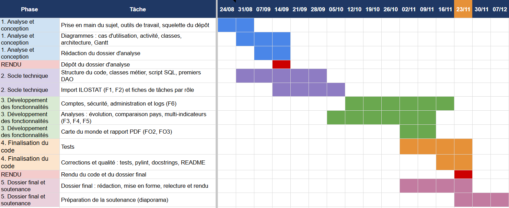
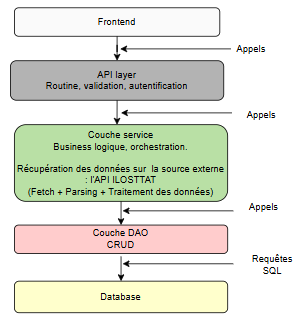
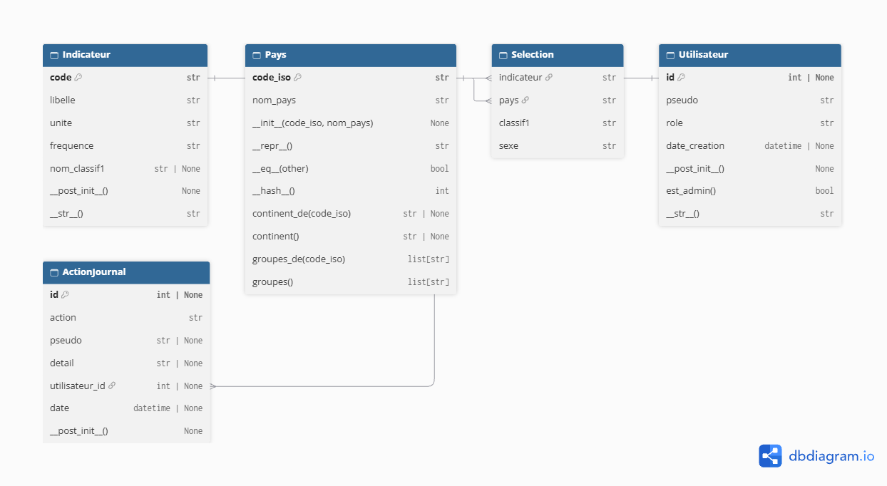
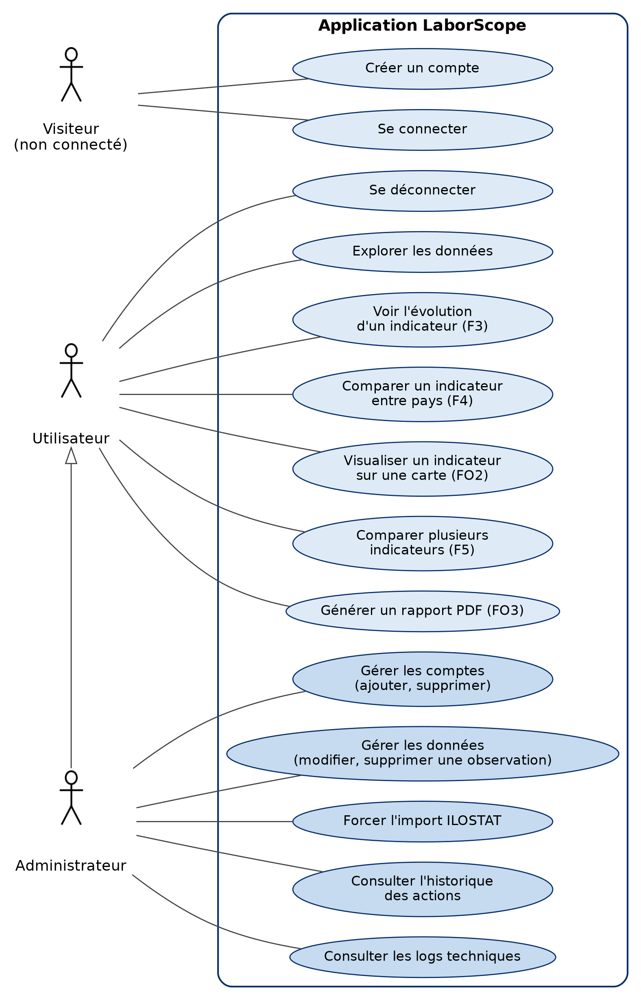
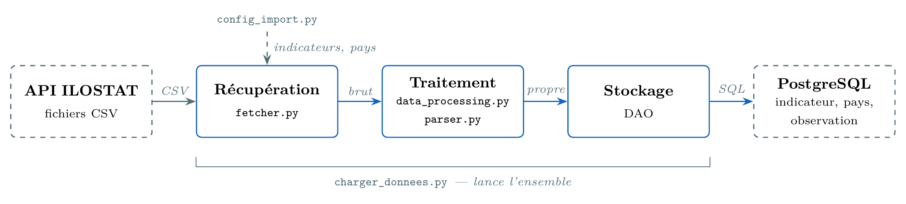
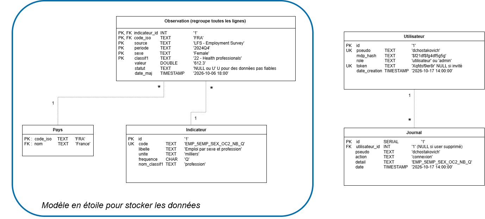
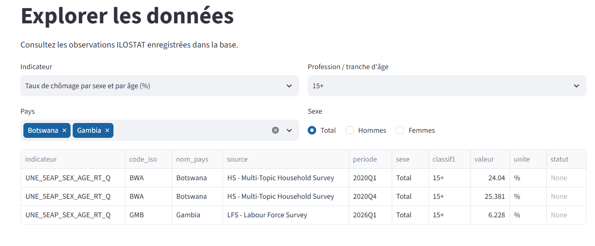
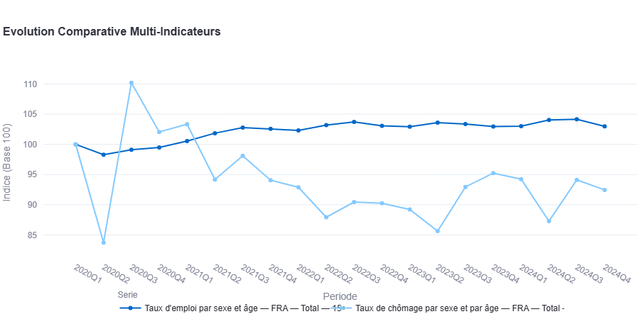
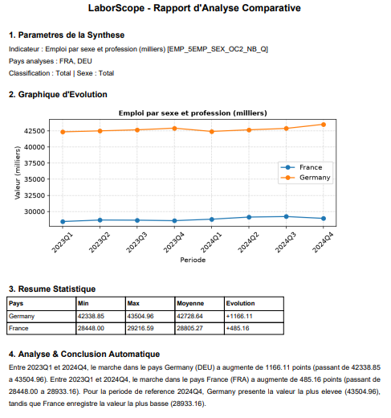

```{r setup, include=FALSE}
# 0. Configuration globale pour la création du document

knitr::opts_chunk$set(
  echo      = FALSE,
  warning   = FALSE,
  message   = FALSE,
  fig.align = "center",
  out.width = "90%"
)

# Couleurs utilisés
COL_MAIN    <- "#1565C0"
COL_ACCENT  <- "#7B2FBE"
COL_THIRD   <- "#FF6F00"
COL_NEUTRAL <- "#546E7A"

library(ggplot2)

# Theme ggplot customisé
theme_ise <- function() {
  theme_bw(base_size = 11) +
  theme(
    axis.title       = element_text(color = COL_MAIN, face = "bold", size = 10),
    axis.text        = element_text(color = "#6B7C85", size = 9),
    plot.title       = element_text(color = COL_MAIN, face = "bold",
                                    size = 12, hjust = 0),
    plot.subtitle    = element_text(color = COL_MAIN, size = 9),
    legend.title     = element_text(color = "#1A6B8A", face = "bold", size = 9),
    legend.text      = element_text(color = "#6B7C85", size = 9),
    legend.position  = "top",
    strip.background = element_rect(fill = COL_MAIN),
    strip.text       = element_text(color = "white", face = "bold", size = 9),
    panel.grid.major = element_line(color = "#E0F4FF", linewidth = 0.4),
    panel.grid.minor = element_blank(),
    panel.border     = element_rect(color = COL_MAIN, linewidth = 0.5),
    panel.background = element_rect(fill = "transparent"),
    plot.background  = element_rect(fill = "#F4F7FC", color = NA)
  )
}

theme_set(theme_ise())

library(kableExtra)

# Theme générique du tableau utilisé dans Quarto
kable_ise <- function(df, caption = NULL, digits = 3,
                      col.names = NULL, escape = TRUE, source = "Source : Nos analyses sous R, WDI(2024)", ...) {
  k <- knitr::kable(
    df,
    format    = "latex",
    booktabs  = TRUE,
    digits    = digits,
    caption   = caption,
    escape    = escape,
    col.names = if (is.null(col.names)) colnames(df) else col.names,
    ...
  )
  k <- k %>%
    footnote(
      general = source,
      general_title = ""
    )
  k %>%
    kable_styling(
      latex_options = c("HOLD_position"),
      font_size     = 11
    ) %>%
    row_spec(0, bold = TRUE, color = "white", background = "#1565C0") %>%
    row_spec(seq(1, nrow(df), 2), background = "#E0F4FF")
}
```

\tableofcontents
\newpage
\listoftables
\newpage
\listoffigures
\newpage

```{=latex}
\mychapterstar{REMERCIEMENTS}
```

Nous tenons à exprimer notre sincère gratitude à toutes les personnes qui ont contribué, de près ou de loin, à la réalisation de ce projet.

Nos remerciements vont tout d'abord à **M. Ludovic DENEUVILLE**, responsable du module, pour son encadrement.

Nous remercions tout particulièrement **M. Anas KNEFATI**, notre tuteur, pour sa disponibilité, la pertinence de ses conseils et ses remarques constructives, qui nous ont permis de faire progresser le projet à chaque étape.

Nous adressons également nos remerciements à l'ensemble de l'équipe pédagogique de l'École nationale de la statistique et de l'analyse de l'information (ENSAI) pour la qualité de la formation dispensée et les ressources mises à notre disposition.

Enfin, nous félicitons les membres du groupe pour leur investissement, leur esprit d'équipe et leur bonne humeur durant ces mois de travail. \newpage

```{=latex}
\mychapterstar{Résumé} 
```

Le projet **LaborScope** vise à rendre accessible l’exploration des données du marché du travail mondial, issues de la base ILOSTAT de l’Organisation internationale du Travail (OIT). Cette base, très riche, rassemble de nombreux indicateurs (emploi, chômage, secteurs d’activité, inégalités entre les sexes…), mais sa taille et sa complexité en limitent l’usage par des utilisateurs non spécialistes.

Pour répondre à ce besoin, nous avons conçu et développé une application interactive permettant d’effectuer des analyses sur une ou plusieurs périodes à partir des indicateurs, de visualiser les évolutions de ces indicateurs sous forme de graphiques et de faire des comparaisons entre plusieurs pays. La démarche suivie comprend une étude préalable (cahier des charges, identification des utilisateurs, structure de la base de données), une phase de conception de l’application, puis une phase de réalisation reposant sur le langage Python, une base de données relationnelle et une interface web réalisée avec Streamlit.

L’application obtenue permet d’explorer rapidement les données ILOSTAT et d’en dégager des tendances, tout en gérant les difficultés propres à ces données : valeurs manquantes, couverture inégale selon les pays et les années, hétérogénéité des définitions. Ce rapport présente la conception, la réalisation et les résultats du projet, puis en dresse les limites et les perspectives d’évolution.

**Mots-clés :** marché du travail, ILOSTAT, visualisation de données, application interactive, conception UML

\newpage

```{=latex}
\mychapterstar{INTRODUCTION}
```

Le marché du travail est au cœur des préoccupations économiques et sociales contemporaines. Chômage, emploi informel, inégalités entre les sexes ou encore évolution des secteurs d’activité : ces indicateurs conditionnent les politiques publiques et les décisions des organisations internationales, des entreprises et des chercheurs. **L’Organisation internationale du Travail (OIT) en assure le suivi à l’échelle mondiale grâce à sa base de données ILOSTAT**, qui rassemble des milliers d’indicateurs harmonisés couvrant la plupart des pays du monde.

Cette richesse constitue pourtant une difficulté. Le volume et la diversité des données rendent leur exploration fastidieuse pour un utilisateur non spécialiste : il faut identifier les bons indicateurs, comprendre leurs définitions, gérer les valeurs manquantes et les différences de couverture entre pays et entre années, puis produire des comparaisons lisibles.Il manque ainsi un outil simple, accessible et interactif permettant d’explorer ces données et d’en dégager rapidement des enseignements.

C’est dans ce contexte que s’inscrit le projet **LaborScope**, réalisé dans le cadre de notre formation à l’École nationale de la statistique et de l’analyse de l’information (ENSAI). Son objectif est de concevoir et de développer une application d’analyse interactive du marché du travail mondial à partir des données ILOSTAT. Elle doit permettre à l’utilisateur de sélectionner un pays, une période et un indicateur, de visualiser les évolutions sous forme de graphiques et de cartes et de comparer plusieurs pays, le tout au sein d’une interface claire et ergonomique.

Dans le rapport intermédiaire, nous avons posé les bases du projet : cahier des charges,identification des utilisateurs, fonctionnalités attendues, structure de la base de données et organisation du travail en équipe. Le présent rapport final en constitue l’aboutissement.Il présente la conception détaillée de l’application, sa réalisation, les choix techniques effectués ainsi que les résultats obtenus.

Ce document s’organise en cinq (05) chapitres. Le premier décrit au préalable le projet(cahier des charges, architecture générale et méthodologie de travail). Le deuxième modélise l’application en expliquant l’ensemble des possibilités qu’offre l’application à ces utilisateurs. Le troisième décrit l’implémentation de l’application depuis la récupération des données jusqu’aux principaux points du fonctionnement du DAO. Le quatrième chapitre explique en détail les différentes fonctionnalités présentes dans l’application ainsi que quelques exemples pratiques.Enfin, le dernier chapitre évoque les retours de chaque membre du groupe par rapport au projet.

\newpage

```{=latex}
\mychapter{Description du projet}
```

```{=latex}
\sectiontitre{Le cahier de charges}
```

```{=latex}
\subsectiontitre{Présentation d’ensemble du projet}
```

Le “LaborScope” est une application dédiée à l’analyse des statistiques mondiales du marché du travail. C’est une application interactive alimentée par les données ouvertes de l'Organisation Internationale du Travail (ILOSTAT). L’objectif de cette application est dans un premier temps, de récupérer des données brutes (des indicateurs) comme l'emploi par sexe et profession, ou la population en âge de travailler depuis le site, de les extraire et de les stocker localement pour des fins d’analyse et de visualisation.

C’est une application sécurisée (avec gestion des utilisateurs et administrateurs) disposant de différentes fonctionnalités permettant de suivre l’évolution des indicateurs dans le temps, faire une comparaison entre plusieurs pays ou croiser plusieurs indicateurs sur un même graphique. Elle peut être complétée par une interface web interactive (Streamlit) pour visualiser les résultats sans avoir à coder et générer automatiquement un rapport d’analyse au format PDF.

L'objectif final est de transformer des données statistiques brutes et complexes en un outil simple qui permet de comprendre, comment évolue l'emploi dans le monde et comment les pays se comparent entre eux.

**Fonctionnalités retenues**

| Code | Fonctionnalité | Type |
|-----------------|---------------------------------------|-----------------|
| F1 | Téléchargement des indicateurs depuis l'API ILOSTAT | Obligatoire |
| F2 | Nettoyage et stockage des données dans PostgreSQL | Obligatoire |
| F3 | Évolution d'un indicateur sur les derniers trimestres | Obligatoire |
| F4 | Comparaison d'un indicateur entre pays (valeurs les plus hautes et les plus basses) | Obligatoire |
| F5 | Comparaison de plusieurs indicateurs sur un même graphique | Obligatoire |
| F6 | Comptes utilisateurs, rôles et administration | Obligatoire |
| FO2 | Carte du monde interactive | Optionnelle |
| FO3 | Rapport d'analyse au format PDF | Optionnelle |

: Fonctionnalités retenues

**Hypothèses de fonctionnement**

L'application repose sur quelques hypothèses :

- les données sont importées à la demande (par un administrateur ou en ligne de commande), et ne sont pas mises à jour en temps réel ;
- elles portent sur trois indicateurs trimestriels, pour environ 80 pays, depuis 2020 ;
- quand plusieurs sources existent pour un même pays et une même période, les analyses qui suivent une série dans le temps n'en gardent qu'une ;
- les analyses sont réservées aux personnes connectées ;
- l'application et sa base de données fonctionnent sur Onyxia, l'environnement de travail de l'ENSAI.

```{=latex}
\subsectiontitre{Identification des utilisateurs}
```

On distingue trois profils dans l’accès aux fonctionnalités de l’application : les visiteurs, les utilisateurs et les administrateurs.

Les visiteurs ne sont pas connectés : ils peuvent seulement créer un compte ou se connecter. Les utilisateurs disposent d’un compte classique leur permettant de consulter des analyses, et de visualiser les données. Ils peuvent également générer de manière automatique des rapports d’analyse au format PDF contenant les données qu’ils ont consultées. Les administrateurs sont chargés de la gestion des comptes utilisateurs classiques et peuvent modifier ou supprimer des données. Ils peuvent également faire un suivi des activités. Les utilisateurs de l’application ne peuvent pas obtenir le statut d’administrateur. Ceci permet de mieux contrôler l’accès aux modifications des données.

```{=latex}
\sectiontitre{Méthodologie de travail et organisation de l'équipe}
```

```{=latex}
\subsectiontitre{Méthode de travail}
```

Pour livrer l'application à temps, nous avons suivi un diagramme de Gantt (figure ci-dessous). Il découpe le projet en tâches datées, regroupées en cinq phases, et fait apparaître en rouge les dates de rendu. Il nous a servi à vérifier chaque semaine l'avancement du projet, en lien avec nos comptes rendus hebdomadaires.

- **Analyse et conception** (fin août à mi-septembre) : prise en main du sujet et des outils de travail. Nous avons cadré le projet ensemble puis réalisé des diagrammes (cas d'utilisation, activité, classes, architecture, Gantt). Ces éléments ont été rassemblés dans le dossier d'analyse. Ils nous ont permis de nous mettre d'accord sur une vision du projet et des différentes fonctionnalités.
- **Socle technique** (septembre à début octobre) : structure du code, classes métier, script SQL et premiers DAO, puis import des données ILOSTAT (F1, F2). C'est aussi à ce moment que le travail a été réparti en fiches de tâches, une par rôle. Nous avions ainsi un réel socle pour l'application, des premiers jeux de données et une projection du travail de chacun. Tout était alors prêt pour la phase de développement.
- **Développement des fonctionnalités** (octobre à mi-novembre) : comptes, sécurité et administration (F6), analyses (F3, F4, F5), puis carte du monde (FO2) et rapport PDF (FO3). C'est la phase la plus longue : chacun codait sa fonctionnalité en parallèle, sur toutes les couches de l'application. Nous nous sommes entraidés en permanence afin d'éviter les pertes de temps inutiles et de profiter de l'expertise de chacun.
- **Finalisation du code** (novembre) : tests, corrections suite aux remarques du tuteur, harmonisation du code (pylint, docstrings) et README, jusqu'au rendu du code le 25 novembre.
- **Dossier final et soutenance** : la rédaction du dossier a commencé début novembre, une fois les fonctionnalités stabilisées, et s'est terminée avec le rendu du 25 novembre. La préparation du diaporama occupera ensuite les deux dernières semaines, avant la soutenance du 9 décembre.

Le planning a globalement été respecté, chacun a pu coder à son rythme lors du troisième volet.

{width="100%"}

Pour travailler ensemble, nous nous sommes appuyés sur les outils suivants :

| Outil | Utilisation dans le projet |
|-----------------|-------------------------------------------------------|
| GitHub | Dépôt commun du code et du dossier, historique de toutes les modifications |
| WhatsApp | Échanges quotidiens, questions rapides et organisation des séances |
| Comptes rendus hebdomadaires | Suivi de l'avancement semaine par semaine (12 semaines), dans le dossier `doc/suivi` du dépôt |
| Fiches de tâches | Une fiche par rôle : objectifs, fichiers à écrire, étapes et tutoriels |
| Onyxia | Environnement de travail commun : service VSCode pour coder, service PostgreSQL pour la base |
| Réunions avec le tuteur | Validation des choix de conception et retours sur l'avancement |
| IA générative | Aide à la compréhension des erreurs, à la rédaction des fiches et à la relecture, conseillée par l'équipe enseignante |
| Quarto | Rédaction du dossier final à plusieurs, dans le dépôt |

: Outils de travail utilisés par l'équipe

```{=latex}
\subsectiontitre{Organisation de l'équipe}
```

Le projet a été réalisé par cinq membres. Pour avancer en parallèle sans se bloquer, le travail a été découpé en cinq rôles, chacun décrit dans une fiche de tâches détaillée (objectifs, fichiers à écrire, étapes, tutoriels) rédigée par Laurent Khaouli. Le partage suit un principe simple : deux membres construisent le socle commun, et les trois autres codent chacun une fonctionnalité complète, de la base de données jusqu’à l’écran. Cela leur permet de toucher toutes les couches de l’application.

\textbf{•Le socle commun}

-Clarence Chemla-Vidaud (rôle A : données et administration). Elle est responsable de tout ce qui touche aux données : import depuis ILOSTAT (fetcher), base de données, gestion des pays et des modalités, actions d’administration sur les données (F1, F2 et la partie données de F6). Elle assure aussi la qualité du projet : infrastructure de tests, journalisation (logs) et README. En fin de projet, elle a relu l’ensemble du backend, harmonisé le code avec pylint et simplifié plusieurs fichiers (schémas, controllers).\newline -Laurent Khaouli (rôle B : utilisateurs, sécurité et squelette frontend). Il gère les comptes (création, connexion, rôles utilisateur et administrateur, historique des actions, partie comptes de F6) et construit le squelette de l’application Streamlit dans lequel chacun a ajouté sa page. Il a aussi conçu l’organisation du travail en fiches et testé le fonctionnement des endpoints.

\textbf{•Les fonctionnalités}

-Antifa Badarou (rôle C : évolution d’un indicateur, F3). Elle a codé le calcul de l’évolution d’un indicateur sur les N derniers trimestres : service, schéma, controller, tests, puis la page d’affichage des graphiques. Elle a fournit le template pour la rédaction du dossier final et effectué des mises en formes et réglages global du document.Elle a aussi rédigé avec l'aide des autres membres le dossier final.\newline

-William Margerand (rôle D : comparaison entre pays, F4, et carte du monde, FO2). Il a codé le classement des pays pour la période la plus récente (valeurs les plus hautes et les plus basses) avec ses tests, puis la carte choroplèthe. Il a ensuite amélioré le choix de la période, la période commune et les couleurs. Il a rédigé les sections du dossier consacrées à F4 et FO2, à l’exploration des données, ainsi que le chapitre 2 de modélisation et le diagramme de cas d’utilisation.\newline

-Christian Adjeba (rôle E : comparaison multi-indicateurs, F5, et rapport PDF, FO3). Il a codé la comparaison de plusieurs indicateurs sur un même graphique (schéma, controller, service), puis la génération automatique du rapport PDF (service, controller, tests et page frontend). Il a aussi amélioré F5 après les échanges avec le tuteur et harmonisé les noms d’indicateurs dans le rapport.\newline

\textbf{•Organisation commune}

Chacun a rédigé ses propres sections du dossier final et tenu un compte rendu hebdomadaire (12 semaines). Les fichiers partagés, comme main.py, n’ont reçu qu’une ligne par controller, ce qui a limité les conflits. Les relectures croisées et les échanges réguliers avec le tuteur ont permis de valider les choix de conception.

```{=latex}
\sectiontitre{Réadaptation des diagrammes}
```

A la suite du dépôt du rapport intermédiaire, notre tuteur nous a fait des remarques concernant le diagramme d'architecture et le diagramme de classe. Nous avons donc intégré ses remarques et amélioré les diagrammes concernés.

```{=latex}
\subsectiontitre{Diagramme d'architecture}
```

Afin d'offrir une expérience utilisateur optimale et de valoriser pleinement les analyses statistiques produites, nous avons retenu une architecture découplée associant une **API REST** (FastAPI) et une **interface web interactive** (Streamlit). Ce choix architectural présente trois avantages majeurs pour le projet :

- **un meilleur impact visuel et ergonomique** : l'interface Streamlit permet de restituer directement les résultats sous forme de graphiques interactifs, de cartes choroplèthes et de comparaisons multi-séries accessibles sans manipulation technique ;
- **un pipeline de données complet et maîtrisé** : la chaîne couvre l'ensemble du cycle de vie de la donnée, depuis la collecte sur l'API externe ILOSTAT jusqu'à la visualisation finale, en passant par le nettoyage, le stockage relationnel et l'exposition via notre propre API ;
- **une couverture optimale des fonctionnalités attendues** : la séparation entre la logique métier côté serveur et l'affichage côté client facilite l'intégration de traitements avancés (normalisation en Base 100, génération de rapports PDF, gestion des rôles utilisateurs) tout en garantissant la maintenabilité du code.

{width="85%"}

Le tableau suivant présente les technologies utilisées dans chaque couche de l'application, et la raison de leur choix :

| Couche | Outils | Rôle et raison du choix |
|----------------|----------------|----------------------------------------|
| Langage et environnement | Python 3.12, uv | Langage commun à tout le groupe ; uv installe les mêmes versions des bibliothèques chez chacun (fichier `uv.lock`) |
| Récupération des données | requests | Téléchargement des fichiers CSV de l'API ILOSTAT |
| Traitement des données | pandas | Nettoyage des données et calculs des analyses (variations, classements, base 100) directement sur des tableaux |
| Base de données | PostgreSQL, psycopg2 | Base relationnelle fournie par Onyxia ; clés et contraintes garantissent la cohérence des données |
| API | FastAPI, uvicorn | Vérification automatique des paramètres des requêtes et documentation interactive générée seule (page `/docs`) |
| Interface | Streamlit, Plotly | Interface web écrite entièrement en Python, sans HTML ni JavaScript ; graphiques interactifs et carte du monde |
| Rapport PDF | Matplotlib, fpdf2 | Graphique tracé côté serveur, puis assemblé avec les statistiques dans un document PDF |
| Sécurité | bcrypt | Hachage des mots de passe : ils ne sont jamais stockés en clair |
| Référentiels de pays | pycountry_convert, worldcountrygroups | Continent et groupes de chaque pays, sans les écrire à la main |
| Configuration | python-dotenv, PyYAML | Identifiants de connexion lus dans le fichier `.env` (absents du code) ; configuration des logs |
| Qualité | pytest, ruff, pylint | Tests unitaires, vérification du style et de la qualité du code |

: Stack technique de l'application

```{=latex}
\subsectiontitre{Diagramme de classes}
```

Le diagramme de classes a presque entièrement changé depuis le rapport intermédiaire. L'ancien modèle comportait quatre classes : `Observation`, reliée par agrégation à `Pays`, `Indicateur` et `Profession`. En codant l'application, nous l'avons revu sur trois points.

- **Les observations ne sont plus des objets.** Une analyse porte sur des milliers de lignes : créer un objet par ligne aurait été lent, alors que pandas calcule directement sur un tableau (variations, classements, base 100). Les DAO renvoient donc les observations sous forme de DataFrame, et la classe `Observation` a disparu.
- **La classe `Profession` a été supprimée.** Selon l'indicateur, la ventilation est une profession ou une tranche d'âge. Plutôt qu'une classe par type de ventilation, une seule colonne générique, `classif1`, contient la valeur, et l'attribut `nom_classif1` d'`Indicateur` indique ce qu'elle représente. Ajouter un indicateur avec une autre ventilation ne demande donc aucune nouvelle classe.
- **Les classes restantes ont été adaptées.** `Indicateur` et `Pays` sont identifiés par leur code (code ILOSTAT, code ISO) plutôt que par un identifiant numérique. `Indicateur` gagne son unité et sa fréquence, et vérifie ses attributs à sa création. `Pays` sait retrouver son continent et ses groupes de pays.

Trois classes sont apparues avec les fonctionnalités : `Selection`, qui décrit une courbe de la comparaison multi-indicateurs (F5), `Utilisateur`, pour les comptes et les rôles (F6), et `ActionJournal`, pour le journal des actions. `Utilisateur` ne contient ni le mot de passe ni le jeton de session : ils restent en base, ce qui évite de les faire circuler dans le reste du code.

{width="100%"}

```{=latex}
\sectiontitre{Normes de codage utilisées}
```

Pour que le code reste lisible par les cinq membres du groupe, et par d'autres développeurs après nous, nous avons suivi des conventions communes, vérifiées automatiquement :

- **Style** : la norme PEP 8 de Python (indentation de 4 espaces, deux lignes vides entre les fonctions et les classes, imports en haut du fichier regroupés dans l'ordre : bibliothèque standard, bibliothèques tierces, modules du projet), avec des lignes de 100 caractères au maximum ;
- **Vérification automatique** : ruff contrôle le style et l'ordre des imports, et pylint la qualité du code. Leurs règles sont définies une seule fois dans le fichier `pyproject.toml`, pour que le code de chacun soit contrôlé de la même façon ;
- **Nommage** : des noms en français et explicites (`EvolutionService`, `ObservationDAO`, `lister_classif1`), en CamelCase pour les classes et en snake_case pour les fonctions et les variables ;
- **Documentation** : chaque module, classe et fonction publique a une docstring au format Google (son rôle, puis les sections Args, Returns et Raises), et les paramètres sont annotés avec leur type ;
- **Commentaires** : réservés aux passages qui ne s'expliquent pas d'eux-mêmes, par exemple un choix de traitement des données.

\newpage

```{=latex}
\mychapter{Modelisation de l'application}
```

Pour bien comprendre l'application **Laborscope**, nous expliquons ici l'ensemble des possibilités qu'elle offre selon le type de personne qui l'utilise, puis la façon de naviguer entre ses différentes pages. Pour une meilleure conceptualisation, nous nous appuyons sur un diagramme UML de cas d'utilisation.

```{=latex}
\sectiontitre{Diagramme de cas d'utilisation}
```

L'application distingue trois acteurs :

- le **visiteur**, qui n'est pas connecté : il peut seulement créer un compte ou se connecter ;
- l'**utilisateur**, connecté avec un compte classique : il a accès à toutes les analyses de l'application ;
- l'**administrateur** : il peut faire tout ce que fait un utilisateur (flèche d'héritage sur le diagramme) et dispose en plus des fonctions de gestion de l'application.

{width="42%"}

Ce diagramme a été mis à jour par rapport à celui du rapport intermédiaire. Nous y avons ajouté deux cas d'utilisation apparus pendant le développement : « Explorer les données », qui permet de consulter les observations brutes de la base, et « Forcer l'import ILOSTAT », qui permet à un administrateur de recharger toutes les données depuis l'API de l'OIT.

```{=latex}
\sectiontitre{Navigation dans l'application}
```

L'application se présente sous la forme d'un site web. Un menu latéral, à gauche de l'écran, permet de passer d'une page à l'autre. Son contenu change selon le rôle de la personne connectée : chacun ne voit que les pages auxquelles il a droit.

```{=latex}
\subsectiontitre{Accueil et accès au compte}
```

À l'ouverture de l'application, le visiteur arrive sur la page d'accueil, qui présente brièvement Laborscope et les données ILOSTAT sur lesquelles elle s'appuie. Son menu ne contient que trois pages : « Accueil », « Se connecter » et « Créer un compte ». Deux boutons de la page d'accueil mènent aussi directement à ces deux dernières pages.

Avant la première connexion, il faut créer un compte à l'aide d'un pseudo et d'un mot de passe d'au moins 8 caractères, saisi deux fois pour éviter les fautes de frappe. Deux utilisateurs ne peuvent pas avoir le même pseudo, ce dernier se doit d'être unique. Une fois le compte créé, l'utilisateur est connecté automatiquement. Si son compte existe déjà, il se connecte grâce à son pseudo et son mot de passe.

```{=latex}
\subsectiontitre{Menu utilisateur}
```

Une fois connecté, l'utilisateur retrouve la page d'accueil, qui l'invite à choisir une analyse dans le menu. Celui-ci contient une rubrique « Analyses » avec six pages :

- **Explorer les données** : consulter les observations brutes d'un indicateur sous forme de tableau ;
- **Évolution (F3)** : suivre l'évolution d'un indicateur au cours du temps ;
- **Comparaison pays (F4)** : classer plusieurs pays selon un indicateur ;
- **Carte du monde (FO2)** : afficher un indicateur sur une carte du monde ;
- **Multi-indicateurs (F5)** : comparer plusieurs indicateurs sur un même graphique ;
- **Rapport PDF (FO3)** : générer un rapport synthétique au format PDF.

Ces pages fonctionnent toutes de la même façon : l'utilisateur choisit un indicateur, puis les filtres qui l'intéressent (pays, sexe, tranche d'âge ou profession selon l'indicateur), et le résultat s'affiche sous forme de tableau, de graphique ou de carte. Elles sont détaillées dans le chapitre « Fonctionnement de l'application ».

En bas du menu, l'utilisateur voit le pseudo et le rôle avec lesquels il est connecté, ainsi qu'un bouton « Se déconnecter » qui le ramène au menu du visiteur.

```{=latex}
\subsectiontitre{Menu administrateur}
```

L'administrateur voit le même menu que l'utilisateur, avec en plus une rubrique « Administration » composée de trois pages :

- **Utilisateurs** : afficher la liste des comptes, ajouter un compte en choisissant son rôle (utilisateur ou administrateur) et supprimer un compte ;
- **Données** : forcer un nouvel import des données ILOSTAT, et modifier ou supprimer manuellement une observation ;
- **Logs et historique** : consulter, dans deux onglets, l'historique des actions (connexions, créations et suppressions de comptes, imports et modifications des données...) et les logs techniques de l'application.

Les actions difficiles à annuler (suppression d'un compte ou d'une observation, nouvel import qui écrase les modifications manuelles) ne sont possibles qu'après avoir coché une case de confirmation.

```{=latex}
\subsectiontitre{Contrôle des accès}
```

Cacher les pages dans le menu ne suffit pas à protéger l'application. Chaque page vérifie donc aussi le rôle de la personne qui l'ouvre : un visiteur qui accède à une page d'analyse reçoit le message « Connectez-vous pour accéder à cette page », et un utilisateur qui accède à une page d'administration reçoit le message « Réservé aux administrateurs ». Ces droits sont également vérifiés par l'API, qui refuse les requêtes d'une personne non connectée ou sans les droits nécessaires. Enfin, si la session n'est plus valable (par exemple après une réinitialisation de la base de données), l'utilisateur est prévenu et le menu redevient celui du visiteur.

\newpage

```{=latex}
\mychapter{Implémentation}
```

(obtention des données et fonctionnement du DAO)

Ce chapitre décrit la manière dont LaborScope a été réalisé, depuis les données brutes d’ILOSTAT jusqu’à l’application interactive utilisée par l’utilisateur final. Il présente les choix techniques retenus, l’organisation de la base de donnée et les principaux points de fonctionnement du DAO.

```{=latex}
\sectiontitre{Des données ILOSTAT à la base de données}
```

```{=latex}
\subsectiontitre{Récupération des données}
```

L'application se base sur les données ouvertes de l'API ILOSTAT. Dans un premier temps, il nous fallait comprendre comment cette API fonctionne pour pouvoir décider de la manière d'importer les données.

Le site donne accès à de nombreux indicateurs. Le cahier des charges nous en imposait deux, et nous en avons choisi trois :

- le taux de chômage par sexe et âge ;
- le taux d'emploi par sexe et âge ;
- l'emploi par sexe et profession.

Chaque indicateur a son propre identifiant dans l'URL de l'API (par exemple `EMP_5EMP_SEX_OC2_NB_Q` pour l'emploi par sexe et profession). Nous avons choisi de reconstruire chaque URL à partir de cet identifiant plutôt que de coder les URL en dur. Une URL contient quatre paramètres : `id`, le code de l'indicateur ; `timefrom`, la première année récupérée ; `type=both`, qui permet d'obtenir à la fois le code d'un pays (« FRA ») et son nom (« France ») ; et `format=.csv`, pour recevoir les données sous forme de tableau.

Nos différents indicateurs sont stockés dans un fichier : `backend/src/config_import.py`. Ce fichier contient aussi la liste des 80 pays suivis et l'année de début des données (2020). C'est le seul fichier à modifier si l'on veut ajouter un indicateur ou un pays : le reste du code s'adapte automatiquement.

Pour chaque indicateur, l'import fait un appel à l'API par pays. Si un appel échoue, il est relancé une deuxième fois après 3 secondes. Si ce deuxième essai échoue aussi, le pays est ignoré et l'import passe au pays suivant. Ainsi, une erreur sur un pays ne bloque pas toute la récupération.

```{=latex}
\subsectiontitre{Traitement des données}
```

Le problème est que les tableaux récupérés depuis l'API ne sont pas propres : certaines colonnes sont superflues et leurs noms ne sont pas synthétiques. Il nous fallait donc traiter les données après les avoir récupérées.

Le dossier qui contient tous les fichiers de traitement est `src/fetcher/`. Il contient en particulier quatre fichiers :

- `fetcher.py` : construit les URL nécessaires et télécharge les données de l'API sous forme de tableau (DataFrame) ;
- `parser.py` : nettoie les libellés d'ILOSTAT en retirant leurs préfixes ;
- `data_processing.py` : utilise les méthodes des deux fichiers précédents. Il sélectionne et renomme les colonnes utiles, nettoie les tableaux, puis les enregistre dans la base ;
- `charger_donnees.py` : script final qui lance l'ensemble : récupérer les données d'ILOSTAT, les traiter et les stocker.

Le nettoyage, fait par la méthode `parse_data` de `data_processing.py`, se déroule en quatre étapes :

1.  sélection des colonnes utiles et renommage ;
2.  conversion des valeurs en nombres, puis suppression des lignes sans valeur ;
3.  nettoyage des libellés : par exemple « Age (Youth, adults): 15-24 » devient « 15-24 » et « Sex: Female » devient « Female ». Quand une dimension n'existe pas pour un indicateur, on la remplace par `_NA` ;
4.  suppression des doublons, c'est-à-dire des lignes qui ont le même pays, la même source, la même période, le même sexe et la même modalité.

Le tableau suivant montre les colonnes que nous gardons et leur nouveau nom :

| Colonne ILOSTAT  | Colonne dans notre base | Exemple |
|------------------|-------------------------|---------|
| `ref_area`       | `code_iso`              | FRA     |
| `ref_area.label` | `nom_pays`              | France  |
| `time`           | `periode`               | 2024Q4  |
| `sex.label`      | `sexe`                  | Female  |
| `classif1.label` | `classif1`              | 15-24   |
| `obs_value`      | `valeur`                | 7,5     |

: Colonnes conservées et renommées lors du traitement des données

{width="100%"}

```{=latex}
\subsectiontitre{Stockage, business objects et DAO}
```

Comme nous ne souhaitions pas stocker chaque tableau dans notre environnement, nous avons décidé de travailler avec PostgreSQL. L'objectif est d'avoir nos données sous forme de tables SQL pour pouvoir les utiliser plus facilement. Les DAO (Data Access Objects) nous permettent de communiquer avec la base SQL et d'utiliser les données récupérées.

La structure de la base est définie dans le fichier `data/init_db.sql`, à la racine du projet. Il crée nos trois tables pour les données ILOSTAT, « indicateur », « pays » et « observation ». Ces trois tables fonctionnent de manière très simple : « indicateur » recense tous les indicateurs (3 ici), « pays » recense tous les pays utilisés, et « observation » contient toutes les lignes des tableaux provenant d'ILOSTAT, quel que soit l'indicateur. C'est la table la plus importante de l'application : elle contient toutes les données.

Cette organisation correspond à un modèle en étoile : « observation » est la table de faits, au centre, et « indicateur » et « pays » sont des tables de dimensions qui la complètent. Chaque observation fait référence à un indicateur et à un pays grâce à des clés étrangères. Le dossier `data/` contient aussi un second fichier, `pop_db.sql`, qui fournit un petit jeu de données de secours si l'API est injoignable.

{width="100%"}

Ce schéma montre les deux groupes de tables de la base, qui ne sont pas reliés entre eux. À gauche, le modèle en étoile stocke les données ILOSTAT : chaque observation renvoie à un pays et à un indicateur, et un pays ou un indicateur peut avoir plusieurs observations. À droite, les tables des comptes : le mot de passe n'y est stocké que sous forme de hash, et le jeton de session est vide quand l'utilisateur est déconnecté. Quand un compte est supprimé, ses actions restent dans le journal : `utilisateur_id` passe à NULL, mais le pseudo copié permet de savoir qui les a faites. La dernière colonne de chaque table donne un exemple de valeur.

Une observation est identifiée par une clé primaire composée de six colonnes : l'indicateur, le pays, la source, la période, le sexe et la modalité. Cette clé nous permet de relancer l'import autant de fois que nécessaire sans créer de doublons : grâce à la commande SQL `INSERT ... ON CONFLICT`, une observation déjà présente n'est pas ajoutée une deuxième fois, mais sa valeur est mise à jour.

Chacune de ces trois tables a son propre DAO (`IndicateurDAO`, `PaysDAO` et `ObservationDAO`, dans le dossier `src/dao/`), qui fait le lien entre PostgreSQL et l'application. Les DAO sont les seuls fichiers du projet qui contiennent des requêtes SQL. Ils fonctionnent dans les deux sens :

- en écriture : ils reçoivent un tableau propre et l'insèrent dans la base. Les observations sont envoyées par paquets de 1000 lignes pour aller plus vite. L'ordre d'enregistrement est important : on enregistre d'abord l'indicateur, puis les pays, puis les observations, car une observation ne peut pas faire référence à un pays ou à un indicateur qui n'existe pas encore ;
- en lecture : ils récupèrent les données pour le reste de l'application. Par exemple, la méthode `lire` d'`ObservationDAO` renvoie les observations d'un indicateur et peut les filtrer par pays, période, sexe et modalité.

Tous les DAO passent par une seule connexion à la base, gérée par la classe `DBConnection`. Elle utilise le patron Singleton : une seule instance de la classe peut exister, donc une seule connexion est ouverte et partagée par toute l'application. Les paramètres de connexion (adresse, nom de la base, identifiants) sont lus dans le fichier `.env`, ce qui évite de les écrire dans le code.

Les DAO ne renvoient pas seulement des tableaux : ils peuvent aussi renvoyer des business objects. Ce sont des classes simples, dans le dossier `src/business_object/`, qui représentent les objets que manipule l'application :

- `Indicateur` : le code, le libellé, l'unité, la fréquence et le type de modalité d'un indicateur. Ce sont ces objets qui décrivent les indicateurs dans `config_import.py`. Cette classe vérifie aussi ses attributs à la création, par exemple que la fréquence vaut bien « Q », « A » ou « M » ;
- `Pays` : le code ISO et le nom d'un pays, avec des méthodes pour retrouver son continent et les groupes auxquels il appartient ;
- `Selection` : un indicateur et ses filtres (pays, modalité, sexe), utilisé pour la comparaison multi-indicateurs.

Par exemple, la méthode `lister` de `PaysDAO` renvoie une liste d'objets `Pays`, et celle d'`IndicateurDAO` une liste d'objets `Indicateur`. Les observations, elles, restent sous forme de tableaux pandas, car les services font leurs calculs directement dessus.

Ces classes sont représentées dans le diagramme de classes de la partie « Réadaptation des diagrammes ».

```{=latex}
\subsectiontitre{Limites}
```

Cette chaîne d'import a tout de même quelques limites :

- l'import est lent : comme on fait un appel à l'API par pays et par indicateur, il faut plusieurs centaines d'appels pour tout récupérer. Ici ce n'est pas encore très contraignant. Si la table "observation" dépasse les 500 milles lignes il faudrait travailler avec d'autres outils qui rendent l'import et la lecture plus rapide.
- la couverture est très inégale selon les pays : certains n'ont qu'un seul trimestre dans la base, ce qui limite les comparaisons (voir la carte du monde au chapitre 4).

\newpage

```{=latex}
\sectiontitre{Fiabilité et traçabilité de l'application}
```

```{=latex}
\subsectiontitre{Logs techniques et journalisation}
```

Pour suivre ce qui se passe dans l'application, nous avons mis en place deux systèmes différents : les logs techniques, destinés aux développeurs, et le journal des actions, destiné à l'administrateur.

**Les logs techniques**

Les logs techniques enregistrent le fonctionnement interne du code. Ils sont gérés par le fichier `src/utils/log_utils.py` et configurés dans le fichier `backend/logging_config.yml`. Au lancement de l'application, les logs sont affichés dans la console et écrits dans le fichier `backend/logs/laborscope.log`. Quand ce fichier dépasse 10 Mo, un nouveau fichier est créé, et on garde au maximum les cinq derniers.

Plutôt que d'écrire des lignes de log à la main dans chaque méthode, nous avons créé un décorateur `@log`. Il suffit de l'ajouter au-dessus d'une méthode pour que trois choses soient enregistrées automatiquement : l'entrée dans la méthode avec ses paramètres, la sortie avec un résumé du résultat, et l'erreur si la méthode échoue. Nous l'utilisons en particulier dans les DAO et dans la chaîne d'import des données.

Pour l’implémentation nous nous sommes basé sur celle du template de l’application initiale. Deux choix nous ont permis de garder des logs lisibles :

- les résultats volumineux sont résumés : pour un DataFrame, on écrit seulement son nombre de lignes et de colonnes, pas tout son contenu ;
- les appels imbriqués sont indentés, ce qui permet de voir quelle méthode en appelle une autre.

Enfin, comme les logs contiennent les paramètres des méthodes, il fallait éviter d'y écrire des informations sensibles. Ainsi, la valeur de tout paramètre dont le nom contient un mot comme « mdp », « password » ou « token » est remplacée par `*****`.

**Le journal des actions**

Le journal répond à une demande du cahier des charges : l'administrateur doit pouvoir suivre l'activité des utilisateurs. Contrairement aux logs techniques, il est stocké dans la base de données, dans la table « journal ».

Chaque action enregistrée contient le pseudo et l'identifiant de l'utilisateur, le type d'action, un détail libre et la date. Les types d'action possibles sont définis dans le business object `ActionJournal` :

- les actions sur les comptes : connexion, échec de connexion, déconnexion, création et suppression de compte ;
- les actions sur les données : import des données ILOSTAT, modification et suppression d'une donnée.

L'objet `ActionJournal` vérifie à sa création que l'action fait bien partie de cette liste, ce qui évite d'enregistrer des actions mal écrites.

Le journal suit la même architecture que le reste de l'application : `JournalDAO` écrit et lit dans la table, `JournalService` est appelé par les autres services (par exemple `UtilisateurService` lors d'une connexion), et `journal_controller.py` met le journal à disposition de l'administrateur, avec des filtres par action et par pseudo. L'accès est réservé aux administrateurs.

Deux choix méritent d'être expliqués :

- le pseudo est copié dans le journal au moment de l'action : si le compte est supprimé plus tard, on sait toujours qui a fait l'action ;
- une erreur dans le journal ne fait jamais échouer l'action principale : si l'enregistrement échoue, un avertissement est affiché, mais l'utilisateur peut quand même se connecter.

```{=latex}
\subsectiontitre{Tests}
```

Pour vérifier que notre code fonctionne, et qu'il continue de fonctionner quand on le modifie, nous avons écrit des tests unitaires avec la librairie `pytest`. Ils sont rangés dans le dossier `src/tests/`, avec un sous-dossier par couche de l'application.

Au total, l'application compte 218 tests. Certains tests sont lancés plusieurs fois avec des données différentes. Ils se lancent tous avec la commande `uv run pytest`.

Nos tests sont écrits selon la méthode *Given / When / Then* : on prépare une situation (*Given*), on appelle la méthode testée (*When*), puis on vérifie le résultat (*Then*).

Pour que chaque test ne vérifie qu'une seule couche, nous remplaçons les autres couches par des faux grâce à `unittest.mock` :

- dans les tests du fetcher, l'API ILOSTAT est remplacée : aucun appel réseau n'est fait ;
- dans les tests des services, le DAO est remplacé par un faux qui renvoie un petit tableau écrit à la main. On connaît donc à l'avance le résultat attendu, par exemple un classement de pays ;
- dans les tests des controllers, on utilise le `TestClient` de FastAPI, qui envoie de vraies requêtes HTTP à l'application. On vérifie ainsi qu'un utilisateur non connecté ou non administrateur est bien refusé.

Les tests des DAO sont différents : ils utilisent une vraie base PostgreSQL, car c'est la seule façon de vérifier les requêtes SQL. Pour ne pas abîmer les vraies données, ils n'utilisent que des données de test faciles à reconnaître (le pays « ZZZ », l'indicateur « TEST_DAO »), qui sont supprimées avant et après chaque test. Si la base est injoignable, par exemple sur un ordinateur personnel, ces tests sont ignorés au lieu d'échouer, et la raison est affichée. Les autres tests restent utilisables.

Ces tests ont tout de même une limite : ils ne testent pas le frontend Streamlit, que nous avons vérifié nous même à l'implémentation de chaque fonction ou détail supplémentaire.

\newpage

```{=latex}
\mychapter{Fonctionnement de l'application}
```

```{=latex}
\sectiontitre{Explorer les données}
```

```{=latex}
\subsectiontitre{Présentation de la fonctionnalité}
```

La page « Explorer les données » permet de consulter directement les données ILOSTAT enregistrées dans notre base, sans calcul. L'utilisateur choisit un indicateur, un ou plusieurs pays, une modalité (une tranche d'âge ou une profession selon l'indicateur, le total étant proposé par défaut) et le sexe (Total, Hommes ou Femmes). La page affiche alors un tableau avec une ligne par observation.

Chaque ligne donne le pays, la période, la valeur et son unité, mais aussi la source de la donnée (le nom de l'enquête nationale) et son statut éventuel. Ces informations sont utiles pour savoir d'où vient un chiffre avant de l'utiliser dans une analyse. Les lignes sont triées par pays puis par période. Le tableau affiche au plus 100 observations, ce qui suffit pour quelques pays mais peut couper le résultat si l'utilisateur en choisit beaucoup.

```{=latex}
\subsectiontitre{Fonctionnement technique}
```

La page repose sur les mêmes couches que le reste de l'application :

- la couche DAO (classe ObservationDAO) construit une requête SQL qui joint les tables des observations, des indicateurs et des pays, puis ajoute un filtre pour chaque choix de l'utilisateur ;
- la couche service (classe ObservationService) transmet simplement la demande au DAO, puisqu'il n'y a pas de calcul à faire ;
- la couche controller expose les données avec FastAPI sur l'endpoint GET /observations, réservé aux utilisateurs connectés. Elle renvoie une erreur 404 si l'indicateur n'existe pas ;
- la page Streamlit utilise les menus de sélection communs à toutes les pages et affiche le résultat dans un tableau.

```{=latex}
\subsectiontitre{Exemple et interprétation}
```

On consulte le taux de chômage des 15 ans et plus (hommes et femmes confondus) au Botswana et en Gambie, deux pays qui ont très peu de données dans notre base.

{width="100%"}

Le tableau ne contient que trois lignes. Pour le Botswana, on a deux observations, en 2020Q1 (24,0 %) et en 2020Q4 (25,4 %), qui viennent d'une enquête auprès des ménages (« HS - Multi-Topic Household Survey »). Environ un actif sur quatre y était donc au chômage en 2020. Pour la Gambie, on n'a qu'une seule observation, en 2026Q1 (6,2 %), issue d'une enquête emploi (« LFS - Labour Force Survey »).

Cet exemple montre l'intérêt de la page : avant de comparer ces deux pays, on voit tout de suite que leurs données datent d'années très différentes et viennent de deux types d'enquêtes. Une comparaison directe entre 25 % et 6 % doit donc être faite avec prudence. C'est aussi pour cette raison que les autres fonctionnalités affichent toujours la période de chaque pays.

```{=latex}
\sectiontitre{Evolution d'un indicateur (F3)}
```

```{=latex}
\subsectiontitre{Présentation de la fonctionnalité}
```

L'évolution d'un indicateur permet de suivre comment une valeur change au cours du temps, pour un ou plusieurs pays. L'utilisateur choisit l'indicateur (par exemple le taux d'emploi), les pays, la modalité (une tranche d'âge comme 15+, ou une profession selon l'indicateur) et le sexe (Total, Hommes ou Femmes). Il choisit aussi le nombre de derniers trimestres à afficher, de 2 à 20 (8 par défaut).

La page affiche trois éléments :

- un graphique en courbes avec une courbe par pays, pour voir la tendance de la valeur ;
- un graphique en barres qui montre, pour chaque trimestre, la variation par rapport au trimestre précédent ;
- un tableau détaillé avec la valeur, la variation absolue et la variation en pourcentage.

Deux difficultés ont influencé nos choix. D'une part, la base peut contenir plusieurs sources pour un même pays et un même trimestre : si on les gardait toutes, le graphique aurait deux points à la même date. Nous gardons une seule source par pays et par période (la première par ordre alphabétique). D'autre part, les pays n'ont pas tous le même nombre de trimestres disponibles : le nombre demandé est donc appliqué pays par pays, et un pays qui a moins de données que demandé affiche simplement tout ce qu'il a. Comme le reste de l'application, cette page n'est accessible qu'aux utilisateurs connectés.

```{=latex}
\subsectiontitre{Fonctionnement technique de la fonctionnalité}
```

La fonctionnalité suit l'architecture en couches de l'application :

- la couche DAO lit en base les observations de l'indicateur pour les pays, la modalité et le sexe demandés. Nous avons réutilisé la classe ObservationDAO, qui existait déjà ;
- la couche service (classe EvolutionService) fait les calculs avec pandas ;
- la couche controller expose le résultat avec FastAPI sur l'endpoint GET /analyses/evolution, réservé aux utilisateurs connectés. Elle vérifie les paramètres (par exemple, n_periodes doit être compris entre 1 et 40) et renvoie une erreur 404 si l'indicateur n'existe pas ;
- la page Streamlit appelle cet endpoint et trace les graphiques avec Plotly Express.

Le calcul du service se fait en quatre étapes :

1.  on garde une seule source par pays et par période ;
2.  on trie les observations par pays puis par période (le format « 2024Q4 » se trie dans l'ordre chronologique) ;
3.  on calcule les variations pays par pays : la variation absolue est la valeur moins celle de la période précédente, et la variation en pourcentage est cette différence divisée par la valeur précédente ;
4.  on ne garde que les N dernières périodes de chaque pays.

L'ordre des étapes 3 et 4 est important. Si on coupait avant de calculer, la première période conservée n'aurait pas de variation. On calcule donc les variations sur tout l'historique, puis on garde les N dernières lignes.

Deux cas particuliers sont traités. La première période de chaque pays n'a pas de période précédente : ses variations valent « vide » (null dans le JSON) au lieu d'une valeur inventée. Si la valeur précédente est égale à 0, le pourcentage n'est pas défini (division par zéro) : il est aussi laissé vide, car l'infini n'est pas accepté par le format JSON.

Le service est testé avec pytest : la base est remplacée par de petites données écrites à la main, ce qui permet de vérifier les variations, la coupe aux N dernières périodes pays par pays, le choix d'une seule source, le tri chronologique, la division par zéro et le cas où aucune donnée n'existe. L'endpoint est aussi testé (réponse 200, erreur 404, erreur 422, résultat vide).

```{=latex}
\subsectiontitre{Exemple et interprétation}
```

Nous avons suivi l’emploi total en France (tous sexes et toutes professions confondus) sur les huit derniers trimestres, de 2023Q1 à 2024Q4. L’emploi passe d’environ 28,45 millions à 28,94 millions de personnes, soit une hausse d’environ 1,7 %. L’année 2023 est marquée par une quasi-stagnation, tandis que 2024 connaît une forte progression aux deux premiers trimestres (environ +225 000 puis +330 000 emplois), jusqu’à un maximum d’environ 29,2 millions au troisième trimestre. Le quatrième trimestre 2024 enregistre en revanche un recul d’environ 285 000 emplois. Le graphique en barres met en évidence ces variations d’un trimestre à l’autre, que la courbe ne rend pas aussi lisibles. L’axe de la courbe ne commençant pas à zéro, les écarts paraissent plus marqués qu’ils ne le sont : l’ensemble des valeurs reste dans une fourchette inférieure à 3 %.

.png){width="95%"}

\newpage

La variation se présente comme suit:

.png){width="95%"}

```{=latex}
\sectiontitre{Comparaison entre pays (F4)}
```

```{=latex}
\subsectiontitre{Présentation de la fonctionnalité}
```

La comparaison entre pays permet de comparer un indicateur entre plusieurs pays choisis par l'utilisateur, et de voir rapidement quels pays ont les valeurs les plus hautes et les plus basses. L'utilisateur choisit l'indicateur (par exemple le taux d'emploi), les pays, la modalité (une tranche d'âge comme 15+, ou une profession selon l'indicateur) et le sexe (Total, Hommes ou Femmes). Il choisit aussi combien de pays il veut voir dans les « plus hauts » et les « plus bas » (3 par défaut).

La principale subtilité vient des périodes. Tous les pays ne publient pas leurs données au même rythme : un pays peut avoir des données jusqu'en 2026 alors qu'un autre s'arrête en 2024. Par défaut, nous prenons la dernière période disponible de chaque pays. Ainsi, aucun pays n'est exclu du classement, mais les pays ne sont pas forcément comparés à la même date. Pour que l'utilisateur ne soit pas trompé, la période de chaque pays est toujours affichée, et un message prévient quand les périodes ne sont pas les mêmes. L'utilisateur peut aussi :

- choisir une période précise dans un menu. Si un pays n'a pas de donnée pour cette période, on prend sa dernière période avant celle choisie, jamais une donnée plus récente ;
- cocher une case pour utiliser la dernière période commune à tous les pays choisis. Tous les pays sont alors comparés à la même date. S'il n'existe aucune période commune, la page l'indique.

Enfin, une case permet d'activer ou non la mise en couleur des pays les plus hauts (bleu foncé) et les plus bas (bleu clair). Quand elle est décochée, toutes les barres sont grises. Comme le reste de l'application, cette page n'est accessible qu'aux utilisateurs connectés.

```{=latex}
\subsectiontitre{Fonctionnement technique}
```

La fonctionnalité suit l'architecture en couches de l'application :

- la couche DAO lit en base les observations de l'indicateur pour les pays, la modalité et le sexe demandés. Nous avons réutilisé la classe ObservationDAO, qui existait déjà ;
- la couche service (classe ComparaisonPaysService) fait les calculs avec pandas ;
- la couche controller expose le résultat avec FastAPI sur l'endpoint GET /analyses/comparaison-pays. Elle renvoie une erreur 404 si l'indicateur n'existe pas ;
- la page Streamlit appelle cet endpoint et trace le graphique avec Plotly Express.

Le service est testé avec pytest : la base est remplacée par de petites données écrites à la main, ce qui permet de vérifier le classement, le choix des périodes et les cas particuliers (aucune donnée, aucune période commune).

```{=latex}
\subsectiontitre{Exemple et interprétation}
```

On compare le nombre de personnes en emploi (indicateur « Emploi par sexe et profession », toutes professions confondues, hommes et femmes) entre la France, l'Allemagne, l'Espagne et l'Italie, avec la dernière période disponible et un pays dans les « plus hauts » et un dans les « plus bas ».

{width="95%"}

{width="95%"}

Les quatre pays ont tous leur dernière donnée en 2024Q4 : ils sont donc comparés à la même date et la page n'affiche pas de message d'avertissement. L'Allemagne arrive en tête avec environ 43,5 millions de personnes en emploi (en bleu foncé), devant la France (28,9 millions) et l'Italie (24,0 millions). L'Espagne est en dernière position avec 21,9 millions (en bleu clair), soit à peu près deux fois moins que l'Allemagne.

Il faut faire attention à l'interprétation : cet indicateur donne un nombre de personnes et non un taux. Le classement dépend donc beaucoup de la taille de chaque pays. Pour comparer la situation de l'emploi entre pays, il est plus pertinent de choisir un indicateur en pourcentage, comme le taux d'emploi.

```{=latex}
\sectiontitre{Carte du monde (FO2)}
```

```{=latex}
\subsectiontitre{Présentation de la fonctionnalité}
```

La carte du monde affiche un indicateur pour tous les pays de la base, avec une couleur qui dépend de la valeur : plus la valeur est petite, plus le bleu est clair, et plus elle est grande, plus il est foncé. L'utilisateur choisit l'indicateur, la modalité et le sexe, mais pas les pays, puisque la carte les montre tous. En passant la souris sur un pays, on voit son nom, sa valeur et la période utilisée. Un tableau sous la carte reprend toutes les valeurs affichées.

Le choix de la période fonctionne comme pour la comparaison entre pays : par défaut la dernière période de chaque pays, ou une période choisie dans un menu, ou la dernière période commune à tous les pays grâce à une case à cocher. Les pays sans données apparaissent en blanc.

```{=latex}
\subsectiontitre{Fonctionnement technique}
```

La carte réutilise entièrement la fonctionnalité F4. Nous n'avons pas créé de nouvel endpoint : la page appelle le même endpoint GET /analyses/comparaison-pays, mais sans préciser de pays, ce qui renvoie le classement de tous les pays de la base. La carte est tracée avec la fonction choropleth de Plotly Express. Elle reconnaît directement les codes ISO à trois lettres des pays (FRA, DEU…), qui sont ceux de notre base, donc aucun fichier de carte supplémentaire n'a été nécessaire.

```{=latex}
\subsectiontitre{Exemple et interprétation}
```

On affiche le taux de chômage des 15 ans et plus (hommes et femmes confondus), avec la dernière période disponible de chaque pays.

{width="100%"}

La carte montre 79 pays. Sur la capture, la souris est placée sur l'Afrique du Sud : l'info-bulle indique son taux de chômage (32,9 %) et la période utilisée (2026Q2). Les taux les plus élevés sont à Djibouti (39,0 %, 2025Q4) et en Afrique du Sud (32,9 %, 2026Q2), suivis du Botswana, de l'Angola et du Zimbabwe, tous au-dessus de 20 %. Les plus bas sont en Thaïlande (0,7 %, 2026Q1), au Belize (1,9 %) et au Viêt Nam (2,0 %). La France se situe à 7,5 % (2024Q4).

Cet exemple montre aussi les limites de la carte. Les 79 pays ne sont pas comparés à la même date : on trouve 12 périodes différentes, de 2020Q4 pour le Botswana à 2026Q3 pour les plus récentes. La valeur du Botswana a donc près de six ans d'écart avec celles d'autres pays. Certains pays n'ont qu'une seule période dans la base, ce qui explique qu'il n'existe aucune période commune à tous les pays : la case « dernière période commune » n'est donc utile que pour un petit nombre de pays. Enfin, seuls les pays importés dans notre base apparaissent en couleur ; les autres restent en blanc.

\newpage

```{=latex}
\sectiontitre{Comparaison multi-indicateurs (F5)}
```

```{=latex}
\subsectiontitre{Présentation de la fonctionnalité}
```

La comparaison multi-indicateurs permet de superposer jusqu'à quatre séries sur un même graphique. Elle répond à un besoin fréquent : croiser des indicateurs qui n'ont ni la même unité ni le même ordre de grandeur, comme un taux d'emploi (autour de 68 %), un taux de chômage (autour de 7 à 8 %) ou un nombre de personnes en emploi (en milliers).

Pour chaque série, l'utilisateur choisit un indicateur, un pays, une modalité (une tranche d'âge ou une profession selon l'indicateur) et le sexe. Une case à cocher permet d'activer ou de désactiver chacune des quatre séries. Chaque série est nommée en langage clair (par exemple « Taux d'emploi par sexe et âge - FRA - Total - 15+ ») plutôt qu'avec le code technique d'ILOSTAT. L'utilisateur peut aussi choisir entre deux affichages :

- l'indice en base 100 : toutes les séries sont ramenées à 100 à une même date de départ $t_0$, ce qui permet de comparer leurs évolutions relatives malgré des unités différentes :

$$\text{valeur}_{\text{base 100}}(t) = \frac{\text{valeur}(t)}{\text{valeur}(t_0)} \times 100$$

- les valeurs brutes, plus adaptées quand les séries sont dans la même unité.

Pour que la comparaison reste cohérente, la page applique deux règles. D'abord, les indicateurs choisis doivent avoir la même fréquence (trimestrielle ou annuelle) : si on mélange les deux, la page refuse la comparaison et affiche une erreur. Ensuite, les séries sont alignées sur leur fenêtre commune : la date de départ est la plus récente des premières périodes de chaque série. Sous le graphique, un tableau reprend les données affichées. Comme le reste de l'application, cette page n'est accessible qu'aux utilisateurs connectés.

```{=latex}
\subsectiontitre{Fonctionnement technique}
```

La fonctionnalité suit l'architecture en couches de l'application :

- le business object `Selection` regroupe les paramètres d'une série (indicateur, pays, modalité, sexe) ;
- la couche DAO récupère les informations de chaque indicateur (libellé, unité, fréquence) avec `IndicateurDAO`, et les observations filtrées avec `ObservationDAO`, qui existait déjà ;
- la couche service (fichier `multi_indicateurs_service.py`) vérifie que les indicateurs existent et ont la même fréquence, supprime les doublons par période, aligne les séries sur la période de début commune et calcule la colonne en base 100 avec pandas. Elle construit aussi les intitulés lisibles des séries ;
- la couche controller expose le résultat avec FastAPI sur l'endpoint POST /analyses/multi-indicateurs. Elle reçoit la liste des séries actives et l'option base 100, puis renvoie les séries calculées au format JSON ;
- la page Streamlit affiche les quatre colonnes de sélection (les modalités proposées dépendent de l'indicateur choisi), met en cache les listes d'indicateurs et de pays, et trace le graphique avec Plotly Express (infobulles, zoom, légende cliquable).

Le service et le controller sont testés avec pytest, et le code est contrôlé avec ruff.

```{=latex}
\subsectiontitre{Exemple et interprétation}
```

On compare, pour la France, le taux d'emploi (15 ans et plus, hommes et femmes confondus) et le taux de chômage, de 2020Q1 à 2024Q4, en base 100.

{width="92%"}

Les deux séries démarrent à 100 en 2020Q1, ce qui permet de comparer leurs variations malgré des niveaux de départ très différents. En 2020Q2, le taux de chômage chute autour de 84, puis remonte à 110,2 en 2020Q3, tandis que le taux d'emploi baisse légèrement à 98,3 en 2020Q2. Ce mouvement du chômage s'explique en partie par un effet statistique : pendant le premier confinement, beaucoup de personnes sans emploi ont cessé de chercher du travail et ont donc été comptées comme inactives. À partir de 2021Q1, les deux courbes s'écartent : le taux d'emploi se stabilise entre 103 et 104 (soit 3 à 4 % de plus qu'au début de 2020), alors que le taux de chômage reste sous son niveau initial, entre 86 et 95.

Il faut faire attention à la lecture d'un indice en base 100 : il mesure une variation relative, pas une variation en points de pourcentage. Un taux de chômage à l'indice 90 signifie que le taux a baissé de 10 % par rapport à 2020Q1 (par exemple de 7,5 % à 6,75 %), et non de 10 points. Le résultat dépend aussi de la date de départ : un point de départ différent changerait l'allure des courbes.

```{=latex}
\sectiontitre{Rapport PDF (F03)}
```

```{=latex}
\subsectiontitre{Présentation de la fonctionnalité}
```

La page « Rapport PDF » permet à l'utilisateur de télécharger un rapport d'analyse comparative, sans avoir à copier lui-même les graphiques et les chiffres. Il choisit un indicateur, les pays à comparer et une période, et l'application génère automatiquement un document PDF de quatre parties :

- un rappel des paramètres choisis : l'intitulé complet de l'indicateur, son unité et son code ILOSTAT entre crochets, ce qui permet de retrouver la source ;
- un graphique de l'évolution de l'indicateur pour chaque pays ;
- un tableau de statistiques par pays : minimum, maximum, moyenne et variation sur la période ;
- une conclusion rédigée automatiquement à partir de ces statistiques.

```{=latex}
\subsectiontitre{Fonctionnement technique}
```

La génération automatisée des rapports PDF repose sur un traitement entièrement exécuté côté serveur (FastAPI) afin de garantir la reproductibilité des documents, la rapidité de rendu et l'indépendance vis-à-vis de l'environnement client. Le pipeline technique s'articule en quatre étapes :

- **Extraction et mise en forme des données** : à réception de la requête contenant les paramètres de sélection de l'utilisateur (indicateur, zone géographique, période), le service interroge la base PostgreSQL via la couche DAO et calcule les indicateurs synthétiques (moyenne, minimum, maximum, variation sur la période) ;
- **Rendu graphique hors écran (*headless*) avec Matplotlib (`Agg`)** : le graphique d'évolution temporelle est généré côté serveur à l'aide de la bibliothèque **Matplotlib** configurée avec le moteur de rendu non interactif **`Agg`** (*Anti-Grain Geometry*). Ce choix technique est indispensable dans une architecture web : contrairement aux moteurs graphiques classiques qui nécessitent un serveur d'affichage (X11 ou interface graphique locale), le mode `Agg` produit directement une image matricielle haute résolution en mémoire sans ouvrir de fenêtre à l'écran, évitant ainsi tout blocage ou erreur d'exécution sur le serveur Linux ;
- **Sérialisation en mémoire tampon (`BytesIO`)** : plutôt que d'écrire des fichiers images temporaires sur le disque — ce qui ralentirait les entrées/sorties et poserait des problèmes de concurrence entre utilisateurs simultanés — le graphique est enregistré directement dans un flux binaire en mémoire vive (`io.BytesIO` au format PNG) ;
- **Composition et exposition du document avec FPDF2** : la bibliothèque **FPDF2** assemble dynamiquement le document en intégrant l'en-tête institutionnel, les métadonnées de la requête, le tableau récapitulatif des statistiques et l'image extraite du flux mémoire. Le fichier PDF final est ensuite renvoyé sous forme de flux binaire (`StreamingResponse`) à l'interface Streamlit, qui le met immédiatement à disposition de l'utilisateur via un bouton de téléchargement.

```{=latex}
\subsectiontitre{Exemple et interprétation}
```

On génère le rapport pour l'indicateur « Emploi par sexe et profession (milliers) », en comparant l'Allemagne et la France de 2023Q1 à 2024Q4.

{width="100%"}

Le graphique met tout d'abord en évidence un écart de niveau structurel important entre les deux marchés du travail : sur l'ensemble de la période étudiée (2023Q1 à 2024Q4), l'emploi total en Allemagne oscille entre $42\,338{,}85$ et $43\,504{,}96$ milliers de personnes (soit environ $42{,}3$ à $43{,}5$ millions d'actifs occupés), contre $28\,448{,}00$ à $29\,216{,}59$ milliers en France (environ $28{,}4$ à $29{,}2$ millions). On observe ainsi un écart de niveau d'environ $14$ millions d'emplois entre les deux pays sur toute la fenêtre d'observation.

Au-delà de ce décalage de volume, l'analyse des variations calculées automatiquement dans le rapport PDF permet d'apprécier le dynamisme respectif des créations nettes d'emplois sur la période : l'emploi total progresse de $+1\,166{,}11$ milliers en Allemagne (soit une hausse relative de $+2{,}75\,\%$ entre début 2023 et fin 2024), contre $+485{,}16$ milliers en France (soit $+1{,}71\,\%$). Sur cette fenêtre temporelle, le marché du travail allemand enregistre ainsi un volume de créations nettes plus de deux fois supérieur à celui de la France, ainsi qu'un rythme de croissance relative environ $1{,}6$ fois plus élevé.

L'utilisateur dispose ainsi, en un seul document PDF, des ordres de grandeur absolus et des amplitudes de variation nécessaires pour appuyer son diagnostic économique.

Comme pour la comparaison entre pays (F4), cet indicateur est un nombre de personnes et non un taux : l'écart entre les deux pays reflète surtout leur taille, et non la situation de leur marché du travail. Le rapport est surtout utile pour garder une trace des paramètres et des chiffres consultés, avec la source de chaque donnée.

\newpage

```{=latex}
\mychapter{Retour sur le projet}
```

```{=latex}
\sectiontitre{Témoignage de Christian}
```

Une dynamique de groupe bienveillante et structurée

Ces trois mois passés aux côtés de mes camarades à concevoir et développer l'application LaborScope ont constitué une expérience particulièrement enrichissante, tant sur le plan humain que technique. Au-delà de l'aspect purement académique, ce projet a avant tout permis de tisser une véritable relation amicale au sein du groupe. Travailler dans un climat de confiance, d'écoute et de bonne humeur avec chacun des membres de l'équipe a été un moteur essentiel tout au long du semestre.

Au démarrage du projet, lors de sa présentation initiale, j'ai ressenti une certaine appréhension : j'avais du mal à cerner concrètement l'ampleur des attentes et la manière dont les différentes briques de l'application allaient s'articuler entre elles. C'est grâce aux échanges réguliers lors de nos séances de travail que j'ai progressivement levé ces zones d'ombre, jusqu'à m'approprier pleinement les objectifs et la logique globale du projet.

L'organisation mise en place par le groupe a largement contribué à cette réussite. Le découpage clair du travail étape par étape initié par Laurent, avec des objectifs précis et des livrables attendus à chaque jalon, nous a donné un cadre rassurant et efficace pour avancer sans nous disperser. De son côté, l'appui précieux de Clarence lors des phases de débogage et de résolution de blocages techniques m'a permis de surmonter rapidement des situations complexes et de gagner en autonomie.

Une vision d'ensemble grâce au développement des fonctionnalités F5 et F03

La réalisation de la comparaison multi-indicateurs (F5) et de la génération de rapport PDF (FO3) a joué un rôle charnière dans ma montée en compétence. Parce que la fonctionnalité F5 se situe au carrefour de l'application et mobilise les briques développées en amont par l'ensemble du groupe (référentiels des pays et des indicateurs, extraction des séries temporelles, gestion des classifications), je ne pouvais pas me contenter de coder de manière isolée. Il m'a fallu comprendre en profondeur le fonctionnement du code de mes camarades afin d'y raccorder proprement mes traitements et d'adapter mon implémentation à l'existant.

Le développement de la fonctionnalité FO3, permettant le téléchargement d'un rapport PDF structuré, a prolongé cette logique en me confrontant à l'automatisation complète de la restitution d'une analyse : assemblage des métadonnées lisibles (intitulés complets et unités des indicateurs), génération de graphiques côté serveur, calcul des indicateurs statistiques clés (minimum, maximum, moyenne, évolution) et synthèse automatique des résultats. Cette transversalité m'a offert une compréhension globale de la construction d'une application informatique, depuis la base de données jusqu'au livrable exploitable par l'utilisateur final.

Apports techniques et travail collaboratif

Sur le plan technique, ce projet m'a permis de franchir un cap important dans ma manière de concevoir, structurer et partager du code au sein d'une équipe. J'ai notamment acquis des compétences essentielles sur plusieurs plans :

la maîtrise d'une architecture en couches rigoureuse : j'ai appris à bien distinguer les responsabilités de chaque composant, en séparant nettement les objets métiers (business_object) — qui modélisent les concepts fondamentaux du domaine comme une sélection d'analyse — des couches d'accès aux données (DAO) et de la logique applicative (services) ;

l'utilisation quotidienne de Git et GitHub : le travail en équipe sur un dépôt commun m'a permis de me familiariser concrètement avec le versionnement du code, la gestion des branches par fonctionnalité, les fusions (merges), la résolution de conflits et la synchronisation régulière avec les avancées des autres membres du groupe ;

l'articulation entre backend et frontend : j'ai compris comment relier proprement une API REST exposée avec FastAPI à une interface interactive développée sous Streamlit, en veillant à la cohérence des formats échangés et à la gestion des erreurs ;

les bonnes pratiques de qualité logicielle : l'écriture de tests unitaires automatisés (pytest) et la vérification systématique du style de code (ruff) avant chaque partage sur GitHub se sont révélées indispensables pour sécuriser nos développements collectifs.

En définitive, cette expérience collective m'a permis de consolider durablement mes compétences en développement logiciel et en travail collaboratif, tout en me donnant confiance dans ma capacité à mener à bien un projet informatique complet, de sa conception initiale jusqu'à son produit final.

```{=latex}
\sectiontitre{Témoignage de Clarence}
```

Le but de l'application est assez proche de ce que l'on pourrait nous demander dans nos futurs travaux et projets. Mon stage de première année consistait à visualiser des données volumineuses en créant une application R Shiny, ce qui ressemble beaucoup à ce projet, hormis le volume de données (la base du stage contenait 10 millions de lignes). Je suis plus à l'aise en R et R Shiny qu'en Python, mais cette expérience m'a quand même beaucoup servi.

Lors de ce projet, je me suis occupée de tout ce qui reposait sur la base de données : l'import, le traitement des données et les DAO (hormis ceux de journal.py et utilisateur.py). J'ai également écrit certains tests. Je me suis aussi chargée des logs, qui ont été moins simples à prendre en main que prévu. Même en m'appuyant sur le code du template de l'application présenté en TP, j'ai eu du mal à comprendre leur fonctionnement, mais tout fonctionne correctement aujourd'hui et j'en suis contente. Je me suis aussi occupée du workflow GitHub, où j'ai rencontré les mêmes difficultés, en m'appuyant là encore sur ce qui existait dans le template. Pour le rapport, j'ai rédigé toute la section 3. Enfin, hormis les deux premières fonctionnalités qui importent et traitent les données, je n'ai pas codé de fonctionnalité qui les exploite directement.

Notre tuteur nous a conseillé de travailler avec l'IA, et nous l'avons tous utilisée, moi y compris. J'ai personnellement du mal à m'attribuer le travail réalisé avec son aide. Je l'utilise surtout quand je suis perdue face à des bugs qui commencent à me décourager, ou pour refaire quelque chose de déjà fait (comme les tests). Je m'en sers aussi pour vérifier que je n'ai rien oublié, notamment lors de la rédaction de ma partie du rapport. Évidemment, je vérifie et je relis ce qu'elle produit, mais j'ai quand même du mal à me l'approprier. Je me demande toujours si c'est réellement un outil qui nous rend plus efficaces en tant qu'étudiants.

Concernant notre groupe, mis à part notre problème de suivi, je trouve qu'il a bien fonctionné : tout le monde s'est impliqué et a fait preuve de sérieux. Nous ne nous connaissions pas tous au départ, et je trouve que nous avons réussi à rendre un bon travail, même s'il reste, et restera toujours, améliorable.

```{=latex}
\sectiontitre{Témoignage d'Antifa}
```

Dans ce projet, j'ai codé la fonctionnalité d'évolution d'un indicateur (F3) sur toutes les couches de l'application : le service qui calcule les variations, l'endpoint, les tests, puis la page Streamlit avec ses graphiques. J'ai aussi pris en charge une grande partie du dossier : création du dossier intermédiaire d'analyse, de la page de garde et du squelette Quarto du dossier final, mise à jour du diagramme d'architecture avec Christian, rédaction de l'introduction et du chapitre 1, et mise en forme générale.

Pour être honnête, mon investissement n'a pas été régulier. Au début, j'ai surtout travaillé sur les documents, alors que le code est arrivé plus tard, à partir de la semaine 6. Ensuite, certaines semaines n'ont pas laissé de trace dans nos suivis (charge de travail d'autres matières, examens, etc). Avec le recul, j'aurais dû commencer la partie code plus tôt, car F3 s'est retrouvée codée en plusieurs étapes espacées dans le temps, et le dossier s'est écrit en fin de projet.

Je n'ai jamais été très à l'aise en programmation, et la fiche de tâches de Laurent m'a été très utile : elle expliquait les étapes, les fichiers à écrire et les pièges à éviter. Je reconnais que sans elle, j'aurais eu du mal à avancer seule. Ce qui m'a vraiment fait comprendre l'application, c'est de suivre le trajet d'une requête, de l'URL jusqu'à la base de données, puis le retour sous forme de graphique. Les outils d'IA m'ont beaucoup aidée pour comprendre les erreurs et les pièges de pandas, comme les valeurs vides ou la division par zéro, mais j'ai dû vérifier moi-même le résultat avec les tests et avec des exemples.

Les principales difficultés ont été techniques. Git m'a posé beaucoup de problèmes : push refusé, conflits sur un même fichier, fichiers modifiés que je ne reconnaissais pas. J'ai aussi eu du mal avec l'organisation des tests et les imports du backend. Certains de mes commits ont un message trop vague, et Clarence a dû relire et corriger une partie de mon code (par exemple la structure du schéma), ce qui est normal pour la qualité du projet, mais montre que j'ai encore des progrès à faire en rigueur.

Je retiens que la qualité d'un projet vient autant de l'organisation et des tests que du code lui-même : détail à première vue anodin, comme l'ordre entre le calcul des variations et la coupe aux N dernières périodes, change complètement le résultat affiché. Je retiens aussi que F3 reste imparfaite : un trimestre manquant n'est pas signalé, et la variation est alors calculée entre deux observations qui ne sont pas consécutives.

Si c'était à refaire, je répartirais mon temps de façon plus régulière, je commencerais le code avant les documents, et je commiterais plus souvent avec des messages clairs. Cette expérience m'a appris à travailler en équipe sur un projet de cette taille, et je m'en servirai pour les futurs projets.

```{=latex}
\sectiontitre{Témoignage de Laurent}
```

Dès le début, je me suis fortement investi dans ce projet. Les TP m'avaient fait découvrir l'architecture complète d'une application en couches (objets métier, DAO, services, API), que je ne connaissais que de loin. Le projet m'a permis de faire le lien entre ces différentes séances et de les assembler dans une application qui fonctionne de bout en bout.

Le groupe était motivé. Nos niveaux en programmation étaient très différents, mais cela n'a pas freiné notre progression. Assez tôt, j'ai proposé une structure du code et une répartition du travail en cinq rôles, selon les envies et les compétences de chacun. Pour chaque rôle, j'ai rédigé avec l'aide de l'IA une fiche de tâches détaillée : objectifs, fichiers à écrire, étapes et tutoriels. Chacun pouvait ainsi avancer de façon autonome, sans attendre les autres.

Ma partie technique portait sur les comptes utilisateurs et la sécurité (F6) : la création de compte et la connexion, le hachage des mots de passe avec bcrypt, le jeton de session, deux rôles (utilisateur et administrateur) dont les droits sont vérifiés par l'API, et un journal des actions importantes. J'ai aussi construit le squelette de l'interface Streamlit : le client de l'API, le menu qui dépend du rôle et les pages d'administration. J'ai ensuite participé à la finalisation, avec la protection des routes d'analyse, le README et la documentation du code. J'ai beaucoup appris sur la gestion des utilisateurs. Je n'imaginais pas le nombre de cas à prévoir : un jeton qui n'est plus valide, un administrateur qui veut supprimer son propre compte, ou un message d'erreur qui ne doit pas révéler si un pseudo existe.

L'équipe enseignante a recommandé d'utiliser l'IA, et c'était selon moi un excellent choix. Nous avons pu consacrer notre temps à l'organisation du travail, aux choix de modélisation et aux choix techniques, plutôt qu'à l'écriture de code répétitif ou à la recherche d'erreurs. Cela m'a aussi appris à garder un regard critique : il fallait toujours relire le code proposé, le tester et l'adapter à notre architecture. J'apprécie d'autant plus ce choix qu'il correspond, je pense, aux attentes actuelles des entreprises. Elles cherchent moins des personnes qui écrivent chaque ligne de code que des data scientists capables d'organiser un projet et de travailler efficacement avec l'IA.

La principale difficulté a été de garder un code cohérent entre cinq personnes qui avancent en parallèle. Il fallait s'accorder sur les noms des fonctions et sur les formats de données échangés entre le backend et l'interface, et gérer les conflits Git. Nous avons passé une partie de la dernière semaine à harmoniser le code (tests, documentation, qualité). Ce travail aurait été plus léger si nous avions fixé ces règles communes dès le départ.

Ce que je retiens surtout, ce sont les compétences d'organisation d'un projet. J'ai toujours à cœur de garder une vision globale sur mes projets, et j'ai pu le faire ici en proposant à l'équipe une structure, une répartition des tâches et une organisation générale. Si c'était à refaire, je fixerais dès le début des règles communes pour le code et les tests, afin d'avoir moins de reprises en fin de projet.

```{=latex}
\sectiontitre{Témoignage de William}
```

Dans ce projet, je me suis occupé de la comparaison d'un indicateur entre pays (F4) et de la carte du monde (FO2). J'ai codé ces deux fonctionnalités sur toutes les couches de l'application, du service jusqu'aux pages Streamlit, en passant par l'endpoint et les tests. En dehors du code, j'ai surtout participé aux réunions, en donnant mon avis sur la manière dont on voyait le projet et sur ce qu'on voulait faire de l'application.

Avant le projet, j'étais très faible en programmation. Je pense avoir beaucoup progressé, en Python mais aussi sur des choses que je n'avais jamais faites, comme la création d'une API ou d'une interface avec Streamlit.

Les rôles se sont répartis assez naturellement. Chacun connaissait ses points forts, et nous n'avons pas eu besoin de désigner un chef de projet ou un référent technique. On se faisait confiance, on s'écoutait et on suivait le plan fixé ensemble, ce qui a rendu le travail très agréable.

Ce plan est pour moi le point fort du projet. Laurent a passé du temps à préparer, avec l'aide de l'IA, une fiche détaillée pour chaque membre : les tâches à réaliser, des étapes claires, des indications et des tutoriels. Chacun pouvait donc avancer de façon autonome et à son rythme, sans trop dépendre des autres, tout en ayant déjà des aides à disposition. Je pense que cette organisation nous a rendus efficaces.

J'ai surtout appris comment se construit un projet de cette taille, en particulier l'architecture technique en couches et l'utilisation des API. Le moment où j'ai vraiment compris le fonctionnement de l'ensemble, c'est en suivant le trajet d'une requête, depuis l'URL jusqu'à la base de données, puis le retour.

Les difficultés ont surtout été techniques, liées à la programmation elle-même, qui n'est pas mon point fort. Les outils d'IA, conseillés par l'équipe enseignante pour ce projet, m'ont beaucoup aidé sur ce point : ils permettent de comprendre un problème très rapidement, ce qui m'a souvent débloqué.

Ce que je retiens avant tout, c'est la répartition et l'organisation du travail, qui ont très bien fonctionné. Avec le recul, la seule chose que je changerais serait de commencer la rédaction du rapport plus tôt. Si cette façon de travailler est possible en stage ou en entreprise, je la reprendrai volontiers.

\newpage

```{=latex}
\mychapterstar{CONCLUSION}
```

Le projet **Laborscope** avait pour objectif de concevoir une application d’analyse interactive du marché du travail mondial à partir des données ILOSTAT. Il aboutit à une application fonctionnelle de bout en bout : une base PostgreSQL alimentée par les données de l’Organisation internationale du travail, une API REST développée avec FastAPI, et une interface web (réalisée avec Streamlit) permettant d’explorer les indicateurs, de les comparer entre pays, de suivre leur évolution dans le temps ,les visualiser sur une carte du monde et surtout imprimer les informations voulues en format pdf.

Sur le plan technique, l’architecture en couches (controllers, services, DAO) et la séparation entre backend et frontend se sont révélées pertinentes. Elles ont permis de répartir le travail entre les membres du groupe, de développer en parallèle sans se bloquer mutuellement, et de tester chaque couche séparément. Les tests automatisés avec pytest, la gestion de l’environnement avec uv et l’utilisation de Git ont renforcé la fiabilité et la reproductibilité du projet.

Ce travail nous a aussi appris à traiter des données réelles, qui sont rarement parfaites. Nous avons dû gérer des sources multiples pour une même observation, des périodes manquantes ou des valeurs nulles pouvant rendre un calcul de variation indéfini. Chaque choix de traitement a dû être justifié et documenté, car il influence directement les résultats affichés à l’utilisateur.

Le projet présente néanmoins des limites.Les trimestres manquants ne sont pas signalés dans le calcul des variations, la qualité des résultats dépend de la couverture inégale des pays dans ILOSTAT, et les performances n’ont pas été optimisées pour de très gros volumes de données.

Plusieurs pistes d’amélioration sont envisageables : ajouter des analyses statistiques plus poussées (tests, régressions, prévisions), mettre en cache les requêtes les plus fréquentes, signaler explicitement les périodes manquantes, enrichir l’application avec d’autres sources de données, et déployer l’ensemble sur un serveur accessible en ligne.

Enfin, ce projet a été une expérience formatrice de travail en équipe : organisation par fiches de tâches, coordination autour de conventions communes, relectures croisées et résolution de conflits Git. Il nous a permis de mettre en pratique, sur un cas concret, les compétences acquises en programmation, en bases de données et en statistiques durant notre deuxième année à l’ENSAI.
