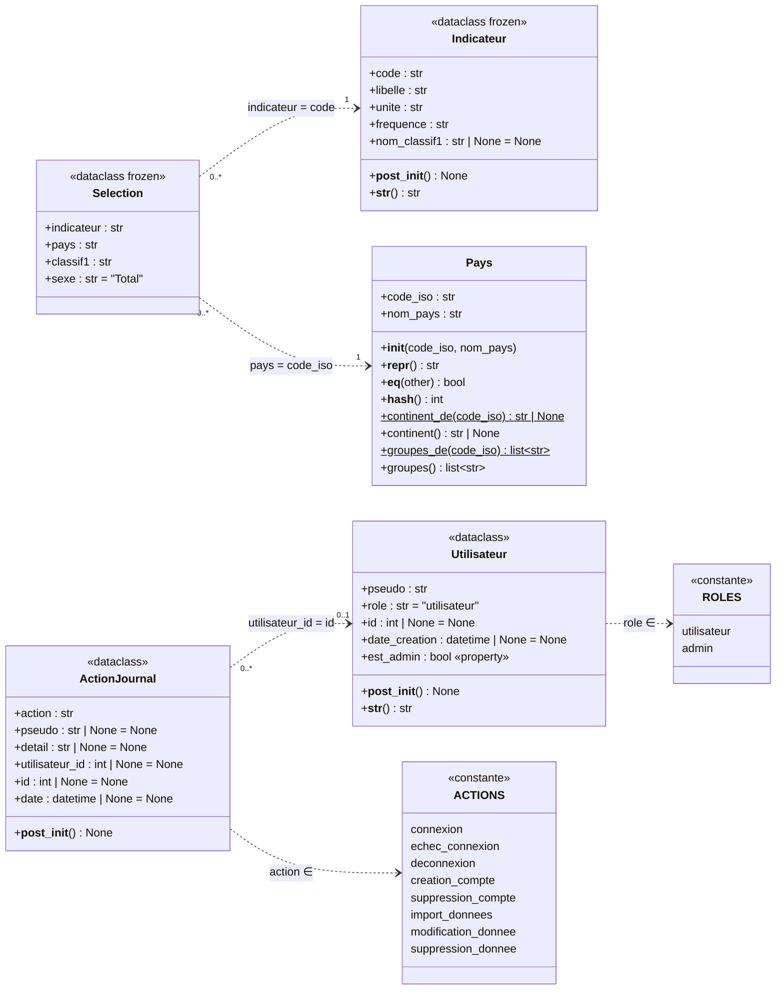

# Diagramme de classes - Objets métier (business_object)

Diagramme limité au dossier [backend/src/business_object/](../../backend/src/business_object/),
fidèle au code actuel.

## Lecture du diagramme

- **Flèches en pointillés** : aucun objet métier ne contient un autre objet métier.
  Les liens se font **par identifiant** (une chaîne ou un entier), par exemple
  `Selection.pays` contient `"FRA"`, pas un objet `Pays`.
- `ActionJournal → Utilisateur` est en `0..1` : `utilisateur_id` passe à `None`
  quand le compte est supprimé (le `pseudo` est copié pour garder la trace).
- `ROLES` et `ACTIONS` ne sont pas des classes mais des constantes de module ;
  elles sont représentées pour montrer les valeurs vérifiées dans `__post_init__`.
- `$` = méthode statique (`@staticmethod`).
