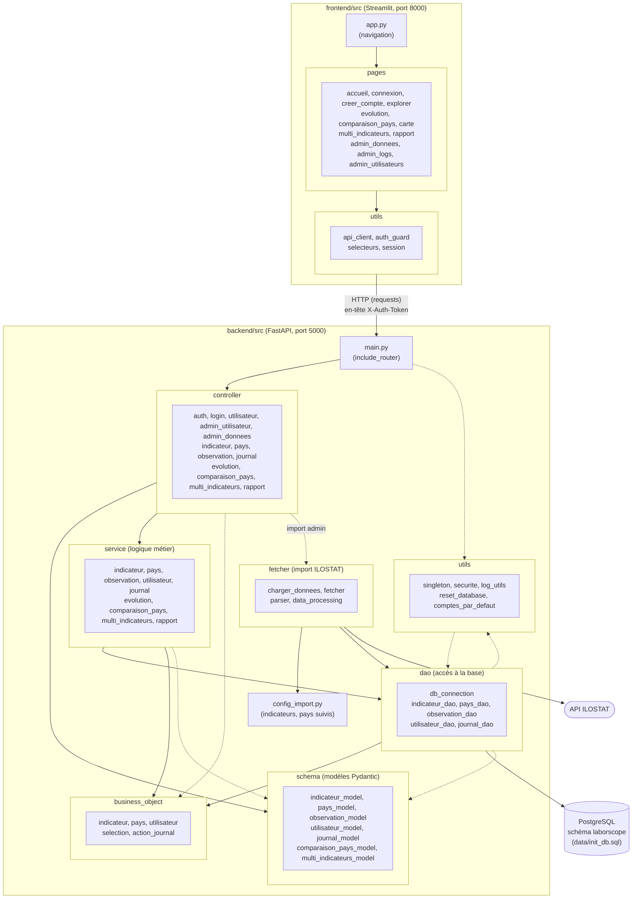

# Diagramme de packages — LaborScope

Une flèche `A --> B` signifie « A importe / utilise B ».
Flèches pleines : dépendances principales (architecture en couches).
Flèches en pointillés : dépendances secondaires.

## Rôle de chaque package

| Package | Rôle |
|---|---|
| `frontend/pages` | Une page Streamlit par fonctionnalité (F3, F4, FO2, F5, FO3, administration…) |
| `frontend/utils` | Client HTTP vers l'API, protection des pages, menus de sélection réutilisés, session |
| `controller` | Endpoints FastAPI : lisent les paramètres, vérifient les droits (`auth`), appellent les services |
| `schema` | Format JSON des entrées / sorties de l'API (Pydantic) |
| `service` | Logique métier (calculs pandas) : ne connaît ni HTTP ni SQL |
| `dao` | Requêtes SQL vers PostgreSQL |
| `business_object` | Objets métier simples (Indicateur, Pays, Utilisateur…) |
| `fetcher` | Import des données depuis l'API ILOSTAT vers la base |
| `utils` (backend) | Connexion unique (singleton), hachage des mots de passe, logs, réinitialisation de la base |
